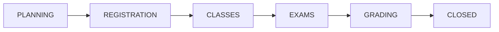

# Clashless — Requirements

**Clashless** is the backend for a university's registration office and exam office. It covers the basics (accounts, roles, courses, fees, payments, grades), but is built around three hard features:

1. **Course registration under load.** 1,000+ students hit 40-seat sections the moment their batch window opens. Seats are first come, first served and can never be overbooked.
2. **Class routine generation.** The system places every section in a room and time slot without clashes.
3. **Exam routine and seat plan generation.** No student has two exams at the same time, and in the exam hall the students on either side of you are sitting a different exam.

**Stack:** Node.js, Express 5, TypeScript, Prisma 7, PostgreSQL, Redis, bKash, Cloudinary, Nodemailer + EJS, PDFKit, node-cron, Zod. **Added for this project:** BullMQ (background jobs), Server-Sent Events (live seat counts), Vitest + Supertest (tests), k6 (load test).

> **How to build it:** use the **express-super-skill** from [AhmadZubayer/skill-library](https://github.com/AhmadZubayer/skill-library/tree/main/express-super-skill) to scaffold the project and write every module. This document says *what* to build; the skill says *how*. [AGENTS.md](AGENTS.md) explains how to get the skill and how to work. [progress.md](progress.md) says what is done and what is next.

## Contents

0. [Read this first](#0-read-this-first)
1. [Roles](#1-roles)
2. [Core rules](#2-core-rules)
3. [Semester lifecycle](#3-semester-lifecycle)
4. [User journeys](#4-user-journeys)
5. [Database schema](#5-database-schema)
6. [API and tests](#6-api-and-tests)
7. [Background jobs and cron](#7-background-jobs-and-cron)
8. [Non-functional requirements](#8-non-functional-requirements)
9. [Testing guide](#9-testing-guide)
10. [Build order and definition of done](#10-build-order-and-definition-of-done)
11. [Decisions already made](#11-decisions-already-made)

[Appendix A. Demo course catalogue](#appendix-a-demo-course-catalogue) (from the AIUB BSc CSE curriculum)

---

## 0. Read this first

### 0.1 How to use this document

- **This document is the source of truth for *what* to build.** Every endpoint, rule, status code and test is listed here. Build exactly what is written. Don't add features that aren't listed.
- **The express-super-skill is the source of truth for *how* to build it:** project setup, folder structure, module files, naming, validation, logging, auth plumbing, the payment module, error handling. Where this document shows code-level details (a model, a path), they already follow the skill's conventions.
- **If this document and the skill seem to disagree,** follow this document for behaviour (what an endpoint does, which rule applies) and the skill for structure (where code goes, how it's written). Write the conflict down in [progress.md](progress.md) under *Decisions log*.
- **If something is missing or truly unclear,** don't guess. Make the smallest choice consistent with this document, write it in the *Decisions log*, and tell the user at the end of your session. Only stop and ask when the choice is hard to undo (a schema change to a finished feature, a new external service, anything involving money or secrets).
- **Section 11 lists decisions already made.** Don't ask the user about them again.
- **Feature IDs (F0–F13)** tie this document to [progress.md](progress.md). Each API section says which feature it belongs to.

### 0.2 Glossary

| Term | Meaning |
|---|---|
| **Course** | A subject in the catalogue, e.g. CSE215 (3 credits, THEORY). Exists across semesters. |
| **Offering** | A course offered in one semester (`CourseOffering`). One per course per semester. |
| **Section** | One class group of an offering, with a teacher, a room, a time and a capacity (default 40). Students select sections, never courses. |
| **Batch** | An intake group such as `23-3` (year 2023, term 3). Registration windows are per batch. |
| **Program** | A degree such as BSc in CSE. It sets the fees. |
| **Registration window** | The time range in which one batch may select and unselect sections, e.g. 14 Nov 4:00 PM → 15 Nov 4:00 AM. |
| **Select / unselect** | A student taking or giving back a seat in a section. Selecting creates an `Enrollment` with status `ENROLLED`. Unselecting sets it to `DROPPED`. |
| **Semester registration** | One student's bill for one semester (`SemesterRegistration`): total credits, total fee, amount paid, payment deadline. Created on the student's first select. |
| **Discard** | The automatic cancellation of every course of a student who didn't pay 40% within 12 days. Their registration becomes `DISCARDED`. |
| **Day pattern** | The days a section meets. THEORY patterns have two days (`ST` = Sunday + Tuesday). LAB patterns have one (`S` = Sunday). |
| **Time slot** | A start and end time in the weekly grid, e.g. 08:30–10:00. THEORY and LAB slots are separate lists. |
| **Class routine** | The weekly timetable: where and when every section meets (`Routine` + `RoutineEntry`). Versions are DRAFT until one is PUBLISHED. |
| **Exam slot** | A date and time in the exam period, e.g. 20 Dec, 9:00–11:00. |
| **Exam routine** | Which exam slot each course's exam is in (`ExamRoutine` + `ExamRoutineEntry`). All sections of a course sit one common exam. |
| **Seat plan** | Where every student sits for one exam slot (`SeatPlan`). The admin types in the rooms for that slot. |
| **Column group** | In the seat plan, group A sits in odd columns (1, 3, 5) and group B in even columns (2, 4). A course belongs to only one group. |
| **Hard rule** | A rule a generated routine or seat plan must never break. |
| **Soft rule** | A preference. Breaking it adds a penalty to the score (lower is better). |
| **Engine** | The pure algorithm code (generators and validators) in `src/app/engine/`. No Express, no Prisma. |
| **SA / AD / FA / ST** | Super Admin, Admin, Faculty, Student. "AD" in an Access column always includes Super Admins. |

### 0.3 Out of scope

Don't build these: a frontend; waitlists; advising or advisor approvals; overload or waiver requests; refunds (except the automatic refund the skill's payment module does when a payable is cancelled while a payment is in progress); Stripe; SMS; attendance; class tests or partial marks (only the final letter grade); multiple campuses; multiple semesters running at once.

---

## 1. Roles

| Role | How they join | How they log in |
|---|---|---|
| **Super Admin** | The first one is created by `npm run db:seed` from the `ADMIN_*` env variables. Later ones are created by a Super Admin | Email + password |
| **Admin** (registrar and exam office) | Created by an Admin or Super Admin | Email + password |
| **Faculty** | Created by an Admin, one by one or by CSV | Email + password |
| **Student** | Created by an Admin (one by one or CSV), then activates the account with an email OTP | Email + password, or Google with their university email |

**Nobody can self-register.** Admin and faculty accounts get a generated password by email and must change it at first login.

### 1.1 Who can manage whom

| Action | Admin | Super Admin |
|---|:---:|:---:|
| Create, block, unblock or delete Faculty and Students | ✅ | ✅ |
| Create an Admin | ✅ | ✅ |
| Create a Super Admin | ❌ | ✅ |
| Block, unblock or delete an Admin or Super Admin | ❌ | ✅ |
| Everything academic (courses, routine, registration, exams, grades) | ✅ | ✅ |

Nobody can block or delete their own account.

---

## 2. Core rules

| Rule | Value |
|---|---|
| Section capacity | 40 by default, set per section |
| Seat allocation | First come, first served. No waitlist: a full section stays full |
| Max credits per student per semester | 15 (`Semester.maxCredits`) |
| Registration window | One per batch per semester, e.g. batch **23-3: 14 Nov 4:00 PM → 15 Nov 4:00 AM** |
| Select / unselect / switch | Only inside the student's own batch window, and only while the semester is in REGISTRATION |
| One section per course | A student can hold only one ENROLLED section of a course |
| Time clash | A student can't hold two sections that share a day and overlap in time |
| Prerequisites | Each prerequisite must be passed with at least its minimum grade (default D) |
| Fee | `totalCredits × program.perCreditFee + program.semesterFee`. The semester fee is charged only while the student has at least one ENROLLED course |
| Minimum payment | `ceil(totalFee × 40 / 100)` in whole taka (`Semester.minPaymentPercent`) |
| Payment deadline | `window.endsAt + 12 days` (`Semester.paymentDeadlineDays`). If `paidAmount` is below the minimum at the deadline, **every course is discarded automatically** |
| Seat plan order | Student ID, or name A–Z (chosen for each seat plan) |
| Seat plan columns | In every room, odd columns hold course group A and even columns hold group B |

**Numbers:** credits and money are Prisma `Decimal`. Compare and add them with Decimal methods, never JavaScript floats. Money is BDT with 2 decimals.

**Time:** store every timestamp in UTC. Accept ISO 8601 strings with an offset (`2026-11-14T16:00:00+06:00`). Show times in `Asia/Dhaka`. Times of day (time slots, exam slots) are minutes from midnight: `510` = 8:30 AM.

**Overlap:** two time ranges overlap when `a.start < b.end && b.start < a.end`. Two sections clash when their day patterns share a day and their time slots overlap.

---

## 3. Semester lifecycle



At most one semester is not CLOSED; that one is **the current semester**. It only moves forward, one step at a time, when an Admin moves it. Each step has a gate the system checks.

| Phase | What happens | Gate to enter |
|---|---|---|
| PLANNING | Courses offered, sections opened, teachers assigned, teacher preferences collected, class routine generated and published, batch windows set | — |
| REGISTRATION | Batch windows open and close; students select, unselect and switch sections; payments open | A published class routine and at least one registration window |
| CLASSES | No more student changes. Payment deadlines run out and unpaid students are discarded. Exam slots, exam routine and seat plans are prepared | Every registration window has ended |
| EXAMS | Exams take place; students look up their seats | Exam routine published, and a published seat plan for every exam slot that has courses |
| GRADING | Teachers submit grades; Admin publishes them | — |
| CLOSED | Read-only | Grades published |

Payments are accepted during REGISTRATION and CLASSES only.

---

## 4. User journeys

### 4.1 Super Admin

1. `npm run db:seed` creates the first Super Admin from `ADMIN_NAME`, `ADMIN_EMAIL` and `ADMIN_PASSWORD`. They must change the password at first login.
2. Creates Admins or other Super Admins with an organization email (the login) and a personal email. The generated password goes to the personal email.
3. Blocks, unblocks or deletes Admins and Super Admins (Admins can't).
4. Can do everything an Admin can, and reviews the audit log of every override.

### 4.2 Admin (registrar and exam office)

**One-time setup**

1. Creates departments, programs (with per-credit fee and semester fee) and batches (e.g. `23-3`).
2. Creates courses with credits, type (THEORY or LAB), prerequisites, and the program term each course is usually taken in.
3. Creates rooms, the weekly time slots and the day patterns.
4. Creates teachers and students, one by one or by CSV, and imports past results so prerequisites and CGPA work.

**Every semester**

1. Creates the semester (defaults: 15 credits, 40%, 12 days).
2. Offers courses, e.g. CSE215 with 10 sections × 40 seats, and assigns a teacher to each section. The system rejects assignments that push a teacher past their credit load.
3. Waits for teachers to mark unavailable and preferred slots, then generates the class routine. Reads the report, moves or pins classes, regenerates if needed, and publishes.
4. Sets each batch's registration window and moves the semester to REGISTRATION.
5. During registration, watches the live dashboard. Opens an extra section or raises capacity where a course fills up. Adds or removes students by hand when needed, always with a reason.
6. After the last window ends, moves the semester to CLASSES. Watches the "at risk" list of students below 40%. At each student's deadline the system discards them automatically if they still haven't paid.
7. Creates exam slots, generates the exam routine, fixes clashes and publishes it.
8. For each exam slot: creates the seat plan, types in the rooms (room number, total seats, seats per column), chooses ID or name order, generates, checks and publishes it. Prints door sheets and attendance sheets, and assigns invigilators.
9. Moves to EXAMS, then GRADING. Chases missing grades, publishes results and closes the semester.

### 4.3 Faculty

1. Gets an account from an Admin. The generated password arrives at their personal email; they change it at first login.
2. Marks their unavailable and preferred time slots for the next semester.
3. Sees their assigned sections and weekly routine, and downloads it as a PDF.
4. Views and exports the student list of each section.
5. Sees the exam dates for their courses and their invigilation duties (room and time).
6. Submits grades for their sections before the deadline, and can edit them until they're published.

### 4.4 Student

1. An Admin creates the account. The student gets an invite email, enters their university email, receives an OTP and sets a password. From then on they can log in with the password, or with Google using their university email.
2. Before registration, they see the published routine, the offered sections, and their own window: *"Your registration opens on 14 Nov at 4:00 PM."*
3. When the window opens, they select sections. It's first come, first served.
   - A full section answers *"This section has reached full capacity"*, plus the other sections of that course that still have seats.
   - The system blocks time clashes, a second section of the same course, going over 15 credits, and missing prerequisites.
   - Seat counts update live. They can unselect a course or switch sections until the window ends.
4. They see their fee and deadline (window end + 12 days) and pay at least 40% through bKash. A receipt PDF arrives by email. They get reminders before the deadline; if they don't pay, all their courses are discarded and they're emailed.
5. During the semester, they see their weekly routine and notifications.
6. Before exams, they see their personal exam routine. When the seat plan is published they get an email with room, column and seat, and can look it up any time.
7. When results are published, they see their grades and updated CGPA.

---

## 5. Database schema

The schema follows the skill's layout: `prisma/schema.prisma` holds only the generator and datasource, `prisma/models/enums.prisma` holds every enum, and every model has its own file in `prisma/models/`, named after the model in camelCase. All files below together pass `prisma validate` on Prisma 7.9.1. **Copy them exactly** (feature F0). The skill already scaffolds `user.prisma`, `payment.prisma` and some enums: replace them with the versions below, and delete the skill's example models (`booking.prisma`, `service.prisma`, `category.prisma`) and the `BookingStatus` enum.

### 5.1 How the models fit together

- **User** is the login for every role, linked 1–1 to exactly one of **Admin** (for SUPER_ADMIN and ADMIN), **Faculty** or **Student**.
- **Department** has many **Program**s, **Course**s and **Faculty**. A **Program** and a **Batch** each have many **Student**s.
- **CoursePrerequisite** links a course to the courses it requires. **CurriculumCourse** says which program term a course is usually taken in.
- **Room**, **TimeSlot** and **DayPattern** make up the weekly grid used by the class routine.
- **Semester** has one **CourseOffering** per offered course. Each offering has many **Section**s.
- **Routine** is one version of the class routine. It has one **RoutineEntry** per section (room + day pattern + time slot). Publishing copies each entry onto its Section, so registration checks clashes without joins.
- **SemesterRegistration** is one student's bill for one semester. It has one **Enrollment** per selected section, and many **Payment**s. It is the *payable* of the skill's payment module.
- **ExamSlot** is a date and time in the exam period. **ExamRoutine** is one version of the exam routine with one **ExamRoutineEntry** per course. Publishing copies the slot onto `CourseOffering.examSlotId`.
- Each exam slot has at most one **SeatPlan**, with its **SeatPlanRoom**s (typed in by the admin), one **SeatAssignment** per student, and **InvigilatorAssignment**s per room.
- **CourseResult** holds every finished course (imported history and published grades). It's used for prerequisites and CGPA.
- **AuditLog**, **Notification** and **GenerationJob** support the rest.

### 5.2 Prisma files

#### `prisma/schema.prisma`

```prisma
generator client {
  provider = "prisma-client"
  output   = "../src/generated/prisma"
}

datasource db {
  provider = "postgresql"
}
```

#### Enums

##### `prisma/models/enums.prisma`

```prisma
// ---- Scaffolded by the skill, changed for this project ----

enum UserRole {
  SUPER_ADMIN
  ADMIN
  FACULTY
  STUDENT
}

enum UserStatus {
  ACTIVE
  BLOCKED
  DELETED
}

enum AuthProvider {
  GOOGLE
  CREDENTIAL
}

enum PaymentProvider {
  BKASH
}

enum PaymentStatus {
  PENDING
  COMPLETED
  FAILED
  CANCELLED
  REFUND_PENDING
  REFUND_FAILED
  REFUNDED
}

// ---- Project enums ----

enum Weekday {
  SAT
  SUN
  MON
  TUE
  WED
  THU
  FRI
}

enum CourseType {
  THEORY
  LAB
}

enum RoomType {
  CLASSROOM
  LAB
}

enum SlotType {
  THEORY
  LAB
}

enum SemesterPhase {
  PLANNING
  REGISTRATION
  CLASSES
  EXAMS
  GRADING
  CLOSED
}

enum SectionStatus {
  OPEN
  CLOSED
  CANCELLED
}

enum PlanStatus {
  DRAFT
  PUBLISHED
  ARCHIVED
}

enum PreferenceKind {
  UNAVAILABLE
  PREFERRED
}

enum RegistrationStatus {
  ACTIVE
  DISCARDED
}

enum RegistrationPaymentStatus {
  UNPAID // less than the minimum (40%) paid: "ready to be paid"
  MINIMUM_PAID // at least 40% paid: safe from the discard job
  FULLY_PAID // everything paid
}

enum EnrollmentStatus {
  ENROLLED
  DROPPED
  DISCARDED
  CANCELLED
}

enum SeatOrder {
  STUDENT_ID
  NAME
}

enum JobType {
  CLASS_ROUTINE
  EXAM_ROUTINE
}

enum JobStatus {
  QUEUED
  RUNNING
  SUCCEEDED
  FAILED
}

enum LetterGrade {
  A
  A_MINUS
  B_PLUS
  B
  B_MINUS
  C_PLUS
  C
  C_MINUS
  D_PLUS
  D
  F
  W
}
```

#### Users and profiles

##### `prisma/models/user.prisma`

```prisma
// Scaffolded by the skill. Added for this project: role values, tokenVersion and the relations.
model User {
  id                 String       @id @default(uuid())
  name               String
  email              String       @unique // login email (university or organization email)
  password           String? // null until a student activates with a password
  googleId           String?      @unique
  authProvider       AuthProvider @default(CREDENTIAL)
  emailVerified      Boolean      @default(false) // students: true after activation
  role               UserRole     @default(STUDENT)
  status             UserStatus   @default(ACTIVE)
  needPasswordChange Boolean      @default(false) // admins and faculty: true until their first password change
  tokenVersion       Int          @default(0) // put in every token; bump it to log the user out everywhere
  imageUrl           String       @default("")
  imagePublicId      String       @default("")
  isDeleted          Boolean      @default(false)
  deletedAt          DateTime?
  createdAt          DateTime     @default(now())
  updatedAt          DateTime     @updatedAt

  admin         Admin?
  faculty       Faculty?
  student       Student?
  notifications Notification[]
  auditLogs     AuditLog[]
  jobs          GenerationJob[]

  @@index([role, status])
  @@map("users")
}
```

##### `prisma/models/admin.prisma`

```prisma
// Profile for SUPER_ADMIN and ADMIN users.
model Admin {
  id            String  @id @default(uuid())
  name          String
  email         String  @unique // organization email = login
  personalEmail String // receives the welcome email with the generated password
  contactNumber String?

  userId String @unique
  user   User   @relation(fields: [userId], references: [id], onDelete: Cascade)

  createdAt DateTime @default(now())
  updatedAt DateTime @updatedAt

  @@map("admins")
}
```

##### `prisma/models/faculty.prisma`

```prisma
model Faculty {
  id            String  @id @default(uuid())
  name          String
  email         String  @unique
  personalEmail String
  designation   String // Lecturer, Assistant Professor, ...
  maxCreditLoad Decimal @default(12) @db.Decimal(4, 1)
  contactNumber String?
  isDeleted     Boolean @default(false)

  userId       String     @unique
  user         User       @relation(fields: [userId], references: [id], onDelete: Cascade)
  departmentId String
  department   Department @relation(fields: [departmentId], references: [id], onDelete: Restrict)

  createdAt DateTime @default(now())
  updatedAt DateTime @updatedAt

  sections        Section[]
  slotPreferences FacultySlotPreference[]
  invigilations   InvigilatorAssignment[]

  @@index([departmentId])
  @@map("faculties")
}
```

##### `prisma/models/student.prisma`

```prisma
model Student {
  id            String  @id @default(uuid())
  universityId  String  @unique // e.g. 2023-3-60-001
  name          String
  email         String  @unique // university email
  personalEmail String?
  contactNumber String?
  cgpa          Decimal @default(0) @db.Decimal(3, 2)
  earnedCredits Decimal @default(0) @db.Decimal(5, 1)
  isDeleted     Boolean @default(false)

  userId    String  @unique
  user      User    @relation(fields: [userId], references: [id], onDelete: Cascade)
  programId String
  program   Program @relation(fields: [programId], references: [id], onDelete: Restrict)
  batchId   String
  batch     Batch   @relation(fields: [batchId], references: [id], onDelete: Restrict)

  createdAt DateTime @default(now())
  updatedAt DateTime @updatedAt

  registrations SemesterRegistration[]
  enrollments   Enrollment[]
  results       CourseResult[]
  seats         SeatAssignment[]

  @@index([programId])
  @@index([batchId])
  @@map("students")
}
```

#### Academic structure

##### `prisma/models/department.prisma`

```prisma
model Department {
  id        String  @id @default(uuid())
  code      String  @unique // CSE
  name      String
  isDeleted Boolean @default(false)

  createdAt DateTime @default(now())
  updatedAt DateTime @updatedAt

  programs  Program[]
  courses   Course[]
  faculties Faculty[]

  @@map("departments")
}
```

##### `prisma/models/program.prisma`

```prisma
model Program {
  id                   String  @id @default(uuid())
  code                 String  @unique // BSCSE
  name                 String
  totalCreditsRequired Decimal @db.Decimal(5, 1)
  perCreditFee         Decimal @db.Decimal(10, 2)
  semesterFee          Decimal @db.Decimal(10, 2) // fixed fee, charged once per semester when the student has at least one course

  departmentId String
  department   Department @relation(fields: [departmentId], references: [id], onDelete: Restrict)

  createdAt DateTime @default(now())
  updatedAt DateTime @updatedAt

  students   Student[]
  curriculum CurriculumCourse[]

  @@index([departmentId])
  @@map("programs")
}
```

##### `prisma/models/batch.prisma`

```prisma
model Batch {
  id         String @id @default(uuid())
  code       String @unique // "23-3"
  intakeYear Int // 2023
  intakeTerm Int // 3

  createdAt DateTime @default(now())
  updatedAt DateTime @updatedAt

  students            Student[]
  registrationWindows RegistrationWindow[]

  @@map("batches")
}
```

##### `prisma/models/course.prisma`

```prisma
model Course {
  id        String     @id @default(uuid())
  code      String     @unique // CSE215
  title     String
  credits   Decimal    @db.Decimal(3, 1)
  type      CourseType
  isDeleted Boolean    @default(false)

  departmentId String
  department   Department @relation(fields: [departmentId], references: [id], onDelete: Restrict)

  createdAt DateTime @default(now())
  updatedAt DateTime @updatedAt

  prerequisites CoursePrerequisite[] @relation("CourseToPrerequisites")
  requiredFor   CoursePrerequisite[] @relation("PrerequisiteToCourses")
  curriculum    CurriculumCourse[]
  offerings     CourseOffering[]
  results       CourseResult[]

  @@index([departmentId])
  @@map("courses")
}
```

##### `prisma/models/coursePrerequisite.prisma`

```prisma
// "courseId needs prerequisiteId, passed with at least minGrade"
model CoursePrerequisite {
  id       String      @id @default(uuid())
  minGrade LetterGrade @default(D)

  courseId       String
  course         Course @relation("CourseToPrerequisites", fields: [courseId], references: [id], onDelete: Cascade)
  prerequisiteId String
  prerequisite   Course @relation("PrerequisiteToCourses", fields: [prerequisiteId], references: [id], onDelete: Cascade)

  createdAt DateTime @default(now())
  updatedAt DateTime @updatedAt

  @@unique([courseId, prerequisiteId], name: "unique_prerequisite")
  @@index([courseId])
  @@index([prerequisiteId])
  @@map("course_prerequisites")
}
```

##### `prisma/models/curriculumCourse.prisma`

```prisma
// Which term of a program a course is normally taken in.
// The routine generator uses it to keep courses taken together clash-free.
model CurriculumCourse {
  id   String @id @default(uuid())
  term Int // 1..12

  programId String
  program   Program @relation(fields: [programId], references: [id], onDelete: Cascade)
  courseId  String
  course    Course  @relation(fields: [courseId], references: [id], onDelete: Cascade)

  createdAt DateTime @default(now())
  updatedAt DateTime @updatedAt

  @@unique([programId, courseId], name: "unique_curriculum_course")
  @@index([programId, term])
  @@index([courseId])
  @@map("curriculum_courses")
}
```

##### `prisma/models/room.prisma`

```prisma
// Rooms used by the CLASS routine. Exam rooms are typed in per seat plan (SeatPlanRoom).
model Room {
  id       String   @id @default(uuid())
  code     String   @unique // "FUB-301"
  building String
  roomNo   String
  type     RoomType
  capacity Int
  isActive Boolean  @default(true)

  createdAt DateTime @default(now())
  updatedAt DateTime @updatedAt

  sections       Section[]
  routineEntries RoutineEntry[]

  @@map("rooms")
}
```

##### `prisma/models/timeSlot.prisma`

```prisma
// Weekly time grid. Times are minutes from midnight: 510 = 8:30 AM.
model TimeSlot {
  id          String   @id @default(uuid())
  label       String // "08:30-10:00"
  type        SlotType
  startMinute Int
  endMinute   Int
  isActive    Boolean  @default(true)

  createdAt DateTime @default(now())
  updatedAt DateTime @updatedAt

  sections       Section[]
  routineEntries RoutineEntry[]
  preferences    FacultySlotPreference[]

  @@unique([type, startMinute], name: "unique_time_slot")
  @@map("time_slots")
}
```

##### `prisma/models/dayPattern.prisma`

```prisma
// THEORY patterns have two days (ST = Sunday + Tuesday). LAB patterns have one day (S = Sunday).
model DayPattern {
  id   String    @id @default(uuid())
  code String    @unique // "ST", "MW", "S"
  type SlotType
  days Weekday[]

  createdAt DateTime @default(now())
  updatedAt DateTime @updatedAt

  sections       Section[]
  routineEntries RoutineEntry[]

  @@map("day_patterns")
}
```

##### `prisma/models/courseResult.prisma`

```prisma
// Every finished course: imported history and published grades. Used for prerequisites and CGPA.
model CourseResult {
  id         String      @id @default(uuid())
  grade      LetterGrade
  gradePoint Decimal     @db.Decimal(3, 2)
  credits    Decimal     @db.Decimal(3, 1)

  studentId  String
  student    Student   @relation(fields: [studentId], references: [id], onDelete: Restrict)
  courseId   String
  course     Course    @relation(fields: [courseId], references: [id], onDelete: Restrict)
  semesterId String? // null for imported history
  semester   Semester? @relation(fields: [semesterId], references: [id], onDelete: Restrict)

  createdAt DateTime @default(now())
  updatedAt DateTime @updatedAt

  @@index([studentId, courseId])
  @@index([courseId])
  @@index([semesterId])
  @@map("course_results")
}
```

#### Semester, offerings and sections

##### `prisma/models/semester.prisma`

```prisma
// At most one semester is not CLOSED at any time: that one is "the current semester".
model Semester {
  id                  String        @id @default(uuid())
  code                String        @unique // "2027-1"
  name                String // "Spring 2027"
  phase               SemesterPhase @default(PLANNING)
  classStartDate      DateTime?
  examStartDate       DateTime?
  examEndDate         DateTime?
  gradeDeadline       DateTime?
  maxCredits          Decimal       @default(15) @db.Decimal(4, 1)
  minPaymentPercent   Int           @default(40)
  paymentDeadlineDays Int           @default(12)

  createdAt DateTime @default(now())
  updatedAt DateTime @updatedAt

  registrationWindows RegistrationWindow[]
  offerings           CourseOffering[]
  routines            Routine[]
  slotPreferences     FacultySlotPreference[]
  registrations       SemesterRegistration[]
  enrollments         Enrollment[]
  examSlots           ExamSlot[]
  examRoutines        ExamRoutine[]
  seatPlans           SeatPlan[]
  results             CourseResult[]
  jobs                GenerationJob[]

  @@map("semesters")
}
```

##### `prisma/models/registrationWindow.prisma`

```prisma
// One registration window per batch per semester, e.g. batch 23-3: 14 Nov 4:00 PM -> 15 Nov 4:00 AM.
model RegistrationWindow {
  id       String   @id @default(uuid())
  startsAt DateTime
  endsAt   DateTime

  semesterId String
  semester   Semester @relation(fields: [semesterId], references: [id], onDelete: Restrict)
  batchId    String
  batch      Batch    @relation(fields: [batchId], references: [id], onDelete: Restrict)

  createdAt DateTime @default(now())
  updatedAt DateTime @updatedAt

  @@unique([semesterId, batchId], name: "unique_batch_window")
  @@index([semesterId])
  @@index([batchId])
  @@map("registration_windows")
}
```

##### `prisma/models/courseOffering.prisma`

```prisma
// A course offered in a semester. It has one or more sections.
model CourseOffering {
  id String @id @default(uuid())

  semesterId String
  semester   Semester  @relation(fields: [semesterId], references: [id], onDelete: Restrict)
  courseId   String
  course     Course    @relation(fields: [courseId], references: [id], onDelete: Restrict)
  examSlotId String? // copied from the published exam routine
  examSlot   ExamSlot? @relation(fields: [examSlotId], references: [id], onDelete: Restrict)

  createdAt DateTime @default(now())
  updatedAt DateTime @updatedAt

  sections    Section[]
  enrollments Enrollment[]
  examEntries ExamRoutineEntry[]
  seats       SeatAssignment[]

  @@unique([semesterId, courseId], name: "unique_offering")
  @@index([semesterId])
  @@index([courseId])
  @@index([examSlotId])
  @@map("course_offerings")
}
```

##### `prisma/models/section.prisma`

```prisma
model Section {
  id            String        @id @default(uuid())
  sectionNo     Int // 1, 2, 3 ... within the offering
  capacity      Int           @default(40)
  enrolledCount Int           @default(0) // the migration adds CHECK (0 <= enrolledCount <= capacity)
  status        SectionStatus @default(OPEN)

  offeringId String
  offering   CourseOffering @relation(fields: [offeringId], references: [id], onDelete: Restrict)
  facultyId  String?
  faculty    Faculty?       @relation(fields: [facultyId], references: [id], onDelete: Restrict)

  // Copied from the published routine, so registration checks clashes without extra joins
  roomId       String?
  room         Room?       @relation(fields: [roomId], references: [id], onDelete: Restrict)
  dayPatternId String?
  dayPattern   DayPattern? @relation(fields: [dayPatternId], references: [id], onDelete: Restrict)
  timeSlotId   String?
  timeSlot     TimeSlot?   @relation(fields: [timeSlotId], references: [id], onDelete: Restrict)

  createdAt DateTime @default(now())
  updatedAt DateTime @updatedAt

  enrollments    Enrollment[]
  routineEntries RoutineEntry[]

  @@unique([offeringId, sectionNo], name: "unique_section_no")
  @@index([offeringId])
  @@index([facultyId])
  @@index([roomId])
  @@index([dayPatternId])
  @@index([timeSlotId])
  @@map("sections")
}
```

##### `prisma/models/facultySlotPreference.prisma`

```prisma
model FacultySlotPreference {
  id   String         @id @default(uuid())
  day  Weekday
  kind PreferenceKind

  facultyId  String
  faculty    Faculty  @relation(fields: [facultyId], references: [id], onDelete: Cascade)
  semesterId String
  semester   Semester @relation(fields: [semesterId], references: [id], onDelete: Cascade)
  timeSlotId String
  timeSlot   TimeSlot @relation(fields: [timeSlotId], references: [id], onDelete: Restrict)

  createdAt DateTime @default(now())
  updatedAt DateTime @updatedAt

  @@unique([facultyId, semesterId, day, timeSlotId], name: "unique_slot_preference")
  @@index([facultyId])
  @@index([semesterId])
  @@index([timeSlotId])
  @@map("faculty_slot_preferences")
}
```

#### Class routine, registration and payments

##### `prisma/models/routine.prisma`

```prisma
// One version of the class routine. Only one version per semester can be PUBLISHED.
model Routine {
  id          String     @id @default(uuid())
  version     Int // 1, 2, 3 ... per semester
  status      PlanStatus @default(DRAFT)
  score       Int? // total soft-rule penalty, lower is better
  report      Json? // unplaced sections with reasons, soft-rule violations
  publishedAt DateTime?

  semesterId String
  semester   Semester @relation(fields: [semesterId], references: [id], onDelete: Restrict)

  createdAt DateTime @default(now())
  updatedAt DateTime @updatedAt

  entries RoutineEntry[]

  @@unique([semesterId, version], name: "unique_routine_version")
  @@index([semesterId])
  @@map("routines")
}
```

##### `prisma/models/routineEntry.prisma`

```prisma
// Where and when one section meets in one routine version.
model RoutineEntry {
  id       String  @id @default(uuid())
  isPinned Boolean @default(false)

  routineId    String
  routine      Routine    @relation(fields: [routineId], references: [id], onDelete: Cascade)
  sectionId    String
  section      Section    @relation(fields: [sectionId], references: [id], onDelete: Cascade)
  roomId       String
  room         Room       @relation(fields: [roomId], references: [id], onDelete: Restrict)
  dayPatternId String
  dayPattern   DayPattern @relation(fields: [dayPatternId], references: [id], onDelete: Restrict)
  timeSlotId   String
  timeSlot     TimeSlot   @relation(fields: [timeSlotId], references: [id], onDelete: Restrict)

  createdAt DateTime @default(now())
  updatedAt DateTime @updatedAt

  @@unique([routineId, sectionId], name: "unique_routine_section")
  @@index([routineId])
  @@index([sectionId])
  @@index([roomId])
  @@index([dayPatternId])
  @@index([timeSlotId])
  @@map("routine_entries")
}
```

##### `prisma/models/semesterRegistration.prisma`

```prisma
// One student's registration and fee bill for one semester. This is the payable of the payment module.
model SemesterRegistration {
  id              String                    @id @default(uuid())
  status          RegistrationStatus        @default(ACTIVE)
  paymentStatus   RegistrationPaymentStatus @default(UNPAID)
  totalCredits    Decimal                   @default(0) @db.Decimal(4, 1)
  totalFee        Decimal                   @default(0) @db.Decimal(10, 2)
  paidAmount      Decimal                   @default(0) @db.Decimal(10, 2)
  paymentDeadline DateTime // batch window end + semester.paymentDeadlineDays
  discardedAt     DateTime?

  studentId  String
  student    Student  @relation(fields: [studentId], references: [id], onDelete: Restrict)
  semesterId String
  semester   Semester @relation(fields: [semesterId], references: [id], onDelete: Restrict)

  createdAt DateTime @default(now())
  updatedAt DateTime @updatedAt

  enrollments Enrollment[]
  payments    Payment[]

  @@unique([studentId, semesterId], name: "unique_student_semester")
  @@index([studentId])
  @@index([semesterId])
  @@index([status, paymentDeadline])
  @@map("semester_registrations")
}
```

##### `prisma/models/enrollment.prisma`

```prisma
// A student holding (or having held) a seat in a section.
model Enrollment {
  id               String           @id @default(uuid())
  status           EnrollmentStatus @default(ENROLLED)
  credits          Decimal          @db.Decimal(3, 1) // copied from the course when selected
  enrolledAt       DateTime         @default(now())
  droppedAt        DateTime?
  grade            LetterGrade? // draft grade entered by the teacher
  gradeSubmittedAt DateTime?

  registrationId String
  registration   SemesterRegistration @relation(fields: [registrationId], references: [id], onDelete: Restrict)
  studentId      String
  student        Student              @relation(fields: [studentId], references: [id], onDelete: Restrict)
  sectionId      String
  section        Section              @relation(fields: [sectionId], references: [id], onDelete: Restrict)
  offeringId     String // copied from the section; used by the one-section-per-course index
  offering       CourseOffering       @relation(fields: [offeringId], references: [id], onDelete: Restrict)
  semesterId     String
  semester       Semester             @relation(fields: [semesterId], references: [id], onDelete: Restrict)

  createdAt DateTime @default(now())
  updatedAt DateTime @updatedAt

  // The migration also adds a partial unique index:
  // one ENROLLED row per (studentId, offeringId). See section 5.3.
  @@unique([studentId, sectionId], name: "unique_student_section")
  @@index([registrationId])
  @@index([studentId])
  @@index([sectionId, status])
  @@index([offeringId, status])
  @@index([semesterId])
  @@map("enrollments")
}
```

##### `prisma/models/payment.prisma`

```prisma
// The skill's payment model, with the example payable (Booking) replaced by SemesterRegistration.
model Payment {
  id                    String          @id @default(uuid())
  transactionId         String          @unique @default(uuid())
  providerTransactionId String?         @unique // bKash paymentID
  providerRefundId      String?         @unique
  amount                Decimal         @db.Decimal(10, 2) // chosen by the student, copied when the payment is created
  method                String?
  provider              PaymentProvider @default(BKASH)
  status                PaymentStatus   @default(PENDING)
  paidAt                DateTime?

  registrationId String
  registration   SemesterRegistration @relation(fields: [registrationId], references: [id], onDelete: Restrict)

  createdAt DateTime @default(now())
  updatedAt DateTime @updatedAt

  @@index([registrationId])
  @@index([status, createdAt])
  @@map("payments")
}
```

#### Exams, seat plans and system

##### `prisma/models/examSlot.prisma`

```prisma
model ExamSlot {
  id          String   @id @default(uuid())
  date        DateTime @db.Date
  startMinute Int // 540 = 9:00 AM
  endMinute   Int

  semesterId String
  semester   Semester @relation(fields: [semesterId], references: [id], onDelete: Restrict)

  createdAt DateTime @default(now())
  updatedAt DateTime @updatedAt

  offerings   CourseOffering[]
  examEntries ExamRoutineEntry[]
  seatPlan    SeatPlan?

  @@unique([semesterId, date, startMinute], name: "unique_exam_slot")
  @@index([semesterId])
  @@map("exam_slots")
}
```

##### `prisma/models/examRoutine.prisma`

```prisma
// One version of the exam routine. Only one version per semester can be PUBLISHED.
model ExamRoutine {
  id          String     @id @default(uuid())
  version     Int
  status      PlanStatus @default(DRAFT)
  report      Json? // unplaced courses, students with 3+ exams a day, back-to-back counts
  publishedAt DateTime?

  semesterId String
  semester   Semester @relation(fields: [semesterId], references: [id], onDelete: Restrict)

  createdAt DateTime @default(now())
  updatedAt DateTime @updatedAt

  entries ExamRoutineEntry[]

  @@unique([semesterId, version], name: "unique_exam_routine_version")
  @@index([semesterId])
  @@map("exam_routines")
}
```

##### `prisma/models/examRoutineEntry.prisma`

```prisma
// Which exam slot one course sits in, in one exam routine version.
model ExamRoutineEntry {
  id       String  @id @default(uuid())
  isPinned Boolean @default(false)

  examRoutineId String
  examRoutine   ExamRoutine    @relation(fields: [examRoutineId], references: [id], onDelete: Cascade)
  offeringId    String
  offering      CourseOffering @relation(fields: [offeringId], references: [id], onDelete: Restrict)
  examSlotId    String
  examSlot      ExamSlot       @relation(fields: [examSlotId], references: [id], onDelete: Restrict)

  createdAt DateTime @default(now())
  updatedAt DateTime @updatedAt

  @@unique([examRoutineId, offeringId], name: "unique_exam_entry")
  @@index([examRoutineId])
  @@index([offeringId])
  @@index([examSlotId])
  @@map("exam_routine_entries")
}
```

##### `prisma/models/seatPlan.prisma`

```prisma
// One seat plan per exam slot. Regenerating a DRAFT replaces all of its seats.
model SeatPlan {
  id          String     @id @default(uuid())
  status      PlanStatus @default(DRAFT)
  orderBy     SeatOrder  @default(STUDENT_ID)
  report      Json? // per room and column: course, first and last ID, count; empty seats; unused rooms
  generatedAt DateTime?
  publishedAt DateTime?

  semesterId String
  semester   Semester @relation(fields: [semesterId], references: [id], onDelete: Restrict)
  examSlotId String   @unique
  examSlot   ExamSlot @relation(fields: [examSlotId], references: [id], onDelete: Restrict)

  createdAt DateTime @default(now())
  updatedAt DateTime @updatedAt

  rooms        SeatPlanRoom[]
  seats        SeatAssignment[]
  invigilators InvigilatorAssignment[]

  @@index([semesterId])
  @@map("seat_plans")
}
```

##### `prisma/models/seatPlanRoom.prisma`

```prisma
// A room the admin typed in for one exam slot, in fill order.
model SeatPlanRoom {
  id             String @id @default(uuid())
  roomNo         String // "301"
  totalSeats     Int // 40
  seatsPerColumn Int // 8
  columns        Int // ceil(totalSeats / seatsPerColumn) = 5
  fillOrder      Int // 1, 2, 3 ... the order the admin listed the rooms in

  seatPlanId String
  seatPlan   SeatPlan @relation(fields: [seatPlanId], references: [id], onDelete: Cascade)

  createdAt DateTime @default(now())
  updatedAt DateTime @updatedAt

  seats        SeatAssignment[]
  invigilators InvigilatorAssignment[]

  @@unique([seatPlanId, roomNo], name: "unique_plan_room")
  @@unique([seatPlanId, fillOrder], name: "unique_plan_fill_order")
  @@index([seatPlanId])
  @@map("seat_plan_rooms")
}
```

##### `prisma/models/seatAssignment.prisma`

```prisma
model SeatAssignment {
  id     String @id @default(uuid())
  column Int // 1-based. Odd columns hold group A, even columns hold group B
  seatNo Int // position in the column, 1 = front
  label  String // "301-C3-S5"

  seatPlanId     String
  seatPlan       SeatPlan       @relation(fields: [seatPlanId], references: [id], onDelete: Cascade)
  seatPlanRoomId String
  room           SeatPlanRoom   @relation(fields: [seatPlanRoomId], references: [id], onDelete: Cascade)
  studentId      String
  student        Student        @relation(fields: [studentId], references: [id], onDelete: Restrict)
  offeringId     String
  offering       CourseOffering @relation(fields: [offeringId], references: [id], onDelete: Restrict)

  createdAt DateTime @default(now())
  updatedAt DateTime @updatedAt

  @@unique([seatPlanRoomId, column, seatNo], name: "unique_seat")
  @@unique([seatPlanId, studentId], name: "unique_student_seat")
  @@index([seatPlanId])
  @@index([seatPlanRoomId])
  @@index([studentId])
  @@index([offeringId])
  @@map("seat_assignments")
}
```

##### `prisma/models/invigilatorAssignment.prisma`

```prisma
model InvigilatorAssignment {
  id String @id @default(uuid())

  seatPlanId     String
  seatPlan       SeatPlan     @relation(fields: [seatPlanId], references: [id], onDelete: Cascade)
  seatPlanRoomId String
  room           SeatPlanRoom @relation(fields: [seatPlanRoomId], references: [id], onDelete: Cascade)
  facultyId      String
  faculty        Faculty      @relation(fields: [facultyId], references: [id], onDelete: Restrict)

  createdAt DateTime @default(now())
  updatedAt DateTime @updatedAt

  @@unique([seatPlanId, facultyId], name: "unique_invigilator_per_slot") // one room per teacher per exam slot
  @@index([seatPlanId])
  @@index([seatPlanRoomId])
  @@index([facultyId])
  @@map("invigilator_assignments")
}
```

##### `prisma/models/notification.prisma`

```prisma
model Notification {
  id      String  @id @default(uuid())
  type    String // ENROLLED, DISCARDED, SEAT_PLAN_PUBLISHED, ...
  title   String
  message String
  isRead  Boolean @default(false)

  userId String
  user   User   @relation(fields: [userId], references: [id], onDelete: Cascade)

  createdAt DateTime @default(now())
  updatedAt DateTime @updatedAt

  @@index([userId, isRead])
  @@map("notifications")
}
```

##### `prisma/models/auditLog.prisma`

```prisma
model AuditLog {
  id       String  @id @default(uuid())
  action   String // SECTION_CAPACITY_CHANGED, MANUAL_ENROLL, REGISTRATION_DISCARDED, ...
  entity   String // Section, Enrollment, Routine, SeatPlan, User ...
  entityId String
  before   Json?
  after    Json?
  reason   String?

  actorId String? // null = the system (a cron job)
  actor   User?   @relation(fields: [actorId], references: [id], onDelete: Restrict)

  createdAt DateTime @default(now())
  updatedAt DateTime @updatedAt

  @@index([entity, entityId])
  @@index([actorId])
  @@map("audit_logs")
}
```

##### `prisma/models/generationJob.prisma`

```prisma
// Tracks a background generation job (class routine or exam routine).
model GenerationJob {
  id         String    @id @default(uuid())
  type       JobType
  status     JobStatus @default(QUEUED)
  progress   Int       @default(0) // 0-100
  input      Json? // options, e.g. { "keepPinnedFrom": "<routineId>" } or { "maxStudentsPerSlot": 1200 }
  resultId   String? // Routine.id or ExamRoutine.id when SUCCEEDED
  error      String?
  startedAt  DateTime?
  finishedAt DateTime?

  semesterId  String
  semester    Semester @relation(fields: [semesterId], references: [id], onDelete: Restrict)
  createdById String
  createdBy   User     @relation(fields: [createdById], references: [id], onDelete: Restrict)

  createdAt DateTime @default(now())
  updatedAt DateTime @updatedAt

  @@index([semesterId, type])
  @@index([createdById])
  @@map("generation_jobs")
}
```

### 5.3 Extra SQL (add by hand to the first migration)

Prisma can't express these two rules. Create the first migration with `npx prisma migrate dev --create-only --name init`, append this SQL to the generated `migration.sql`, then run `npx prisma migrate dev`.

```sql
-- Last line of defence against overbooking: the database refuses enrolledCount > capacity.
ALTER TABLE sections
  ADD CONSTRAINT sections_enrolled_within_capacity
  CHECK ("enrolledCount" >= 0 AND "enrolledCount" <= capacity);

-- A student can hold only one ENROLLED section per course.
-- DROPPED, DISCARDED and CANCELLED rows stay as history and don't count.
CREATE UNIQUE INDEX one_section_per_course
  ON enrollments ("studentId", "offeringId")
  WHERE status = 'ENROLLED';
```

### 5.4 Redis keys

Short-lived data lives in Redis, not Postgres. Key names follow the skill's `<purpose>:<identifier>` pattern.

| Key | TTL | Purpose |
|---|---|---|
| `activation-otp:{email}` | 10 min | Activation OTP + wrong-attempt count |
| `forgot-password-otp:{email}` | 5 min | Password-reset OTP (the skill's existing key) |
| `otp-send-count:{email}` | 15 min | OTP send counter (max 3) |
| `idempotency:{userId}:{key}` | 10 min | Stored response for an `Idempotency-Key` header |
| `rate-limit-registration:{studentId}` | 10 s | Registration request counter (max 10) |
| `catalog:{semesterId}` | 30 s | Cached offerings list, without seat counts |
| `seats:{semesterId}` | — | Pub/sub channel for seat-count changes (feeds the SSE stream) |
| bKash tokens | set by the skill | Gateway tokens, cached the way the skill does it |

---

## 6. API and tests

### 6.1 Conventions

**Paths.** Every path in this document is the full path. Public and user routers are mounted at `/api/<plural>`. Routers whose every endpoint is for Admins only are mounted at `/api/admin/<plural>`. Paths are flat: a resource is never nested under another resource's router; related ids go in the body or query string. In each router, declare fixed paths (`/me`, `/rooms/last-used`, `/read-all`) **before** `/:id`.

**Module map.** One module per resource, in the skill's six-file layout. Pure algorithm code goes in `src/app/engine/` (no Express, no Prisma: plain data in, plain data out). BullMQ workers go in `src/app/jobs/`, the queue client in `src/app/lib/queue.ts`, the Redis pub/sub client for seat counts in `src/app/lib/seatEvents.ts`, cron schedules in the skill's `src/app/lib/cron.ts`.

| Feature | Module folder | Public mount | Admin mount |
|---|---|---|---|
| F1 | `auth` | `/api/auth` | — |
| F2 | `user` | `/api/users` | `/api/admin/users` |
| F3 | `department` | `/api/departments` | `/api/admin/departments` |
| F3 | `program` | `/api/programs` | `/api/admin/programs` |
| F3 | `batch` | `/api/batches` | `/api/admin/batches` |
| F3 | `course` | `/api/courses` | `/api/admin/courses` |
| F3 | `room` | `/api/rooms` | `/api/admin/rooms` |
| F3 | `timeSlot` | `/api/time-slots` | `/api/admin/time-slots` |
| F3 | `dayPattern` | `/api/day-patterns` | `/api/admin/day-patterns` |
| F3 | `result` | — | `/api/admin/results` |
| F4 | `semester` | `/api/semesters` | `/api/admin/semesters` |
| F4 | `registrationWindow` | `/api/registration-windows` | `/api/admin/registration-windows` |
| F5 | `offering` | `/api/offerings` | `/api/admin/offerings` |
| F5 | `section` | `/api/sections` | `/api/admin/sections` |
| F5 | `facultyPreference` | `/api/faculty-preferences` | `/api/admin/faculty-preferences` |
| F6 | `routine` | `/api/routines` | `/api/admin/routines` |
| F6 | `job` | — | `/api/admin/jobs` |
| F7 | `registration` | `/api/registrations` | `/api/admin/registrations` |
| F8 | `payment` (the skill's) | `/api/payments`, `/api/payments/bkash` | `/api/admin/payments` |
| F9 | `examSlot` | `/api/exam-slots` | `/api/admin/exam-slots` |
| F9 | `examRoutine` | `/api/exam-routines` | `/api/admin/exam-routines` |
| F10 | `seatPlan` | `/api/seat-plans` | `/api/admin/seat-plans` |
| F11 | `grade` | `/api/grades` | `/api/admin/grades` |
| F12 | `notification` | `/api/notifications` | — |
| F12 | `analytics` | `/api/analytics` | `/api/admin/analytics` |
| F12 | `auditLog` | — | `/api/admin/audit-logs` |

**Auth.** The skill's cookies and `auth(...roles)` guard. On top of the skill:
- The token payload also carries `tokenVersion`. The guard and `refresh-token` reject a token whose `tokenVersion` is older than the user's, or a user whose status isn't ACTIVE.
- While `needPasswordChange` is true, the guard only lets through `POST /api/auth/change-password`, `GET /api/auth/me` and `POST /api/auth/logout`. Everything else answers `403` with code `PASSWORD_CHANGE_REQUIRED`.

**Responses.** The skill's `sendResponse`: `{ success, statusCode, message, data, meta? }` with `meta = { page, limit, total, totalPages }` on lists.

**Errors.** Throw the skill's `AppError(statusCode, message, errorDetails)`. For every error listed in 6.2, `errorDetails` is an object with a `code` and any extra fields, for example `new AppError(409, "This section has reached full capacity", { code: "SECTION_FULL", alternatives: [...] })`. The client reads `errorDetails.code`. Status codes follow the skill: 400 invalid input, 401 not logged in, 403 not allowed, 404 not found, 409 state conflict; plus 429 for rate limits.

**Lists.** Query `page` (default 1), `limit` (default 10, max 100), `sortBy`, `sortOrder` (`asc` or `desc`, default `desc` on `createdAt`), `searchTerm`, plus the filters named in each row. Validate the query with the skill's `validateQuery`.

**Access column.** SA = Super Admin, AD = Admin (always includes Super Admin), FA = Faculty, ST = Student, Any = any logged-in user, Public = no login.

**Tests column.** After each endpoint table there is a **Tests** table. Each row is one automated test (see [section 9](#9-testing-guide)). Test IDs are referenced from [progress.md](progress.md).

### 6.2 Error codes

| `errorDetails.code` | HTTP | Example message |
|---|---|---|
| `WINDOW_NOT_OPEN` | 403 | Your registration opens on 14 Nov at 4:00 PM |
| `WINDOW_CLOSED` | 403 | Your registration closed on 15 Nov at 4:00 AM |
| `REGISTRATION_DISCARDED` | 403 | Your registration was discarded because 40% wasn't paid in time |
| `PASSWORD_CHANGE_REQUIRED` | 403 | Change your password to continue |
| `ACCOUNT_NOT_ACTIVATED` | 403 | Activate your account first |
| `SECTION_FULL` | 409 | This section has reached full capacity |
| `SECTION_CLOSED` | 409 | This section is closed |
| `ALREADY_HAS_COURSE` | 409 | You already have CSE215 (section 3) |
| `TIME_CLASH` | 409 | Clashes with MAT205 section 2 (ST 10:10–11:40) |
| `CREDIT_LIMIT` | 409 | You have 13 of 15 credits; CSE215 needs 3 |
| `PREREQUISITE_MISSING` | 409 | CSE215 needs CSE207 with at least D |
| `PHASE_NOT_ALLOWED` | 409 | Not allowed while the semester is in PLANNING |
| `HARD_RULE_VIOLATION` | 409 | Room FUB-301 is already used by CSE215 section 3 at that time |
| `NOT_ENOUGH_SEATS` | 409 | CSE215 (70 students) needs 70 odd-column seats; only 48 are left |
| `PAYMENT_IN_PROGRESS` | 409 | You already have a payment in progress |
| `PAYMENT_AMOUNT_INVALID` | 400 | Minimum payment is ৳18,400; maximum is ৳46,000 |
| `INVALID_OTP` | 400 | The OTP is wrong or has expired |
| `RATE_LIMITED` | 429 | Too many requests, try again in a few seconds |

Errors without a listed code (validation errors, plain 404s) use the skill's default format.

### 6.3 Auth — F1

The skill scaffolds the auth module with self-registration. **Remove `POST /api/auth/register` and `POST /api/auth/verify-email`**: nobody self-registers. Reuse their OTP code for activation.

| HTTP Method | Endpoint | Core logic | Description | Access |
|---|---|---|---|---|
| POST | `/api/auth/login` | Skill's login. Also: a student with `emailVerified = false` gets 403 `ACCOUNT_NOT_ACTIVATED`; BLOCKED or DELETED users are rejected; the response includes `needPasswordChange`. | Email/password login for every role. | Public |
| POST | `/api/auth/refresh-token` | Skill's refresh, plus the `tokenVersion` and status check. | Get a new token pair. | Public (cookie) |
| POST | `/api/auth/logout` | Increment `tokenVersion` (ends every session) and clear the cookies. | Log out on all devices. | Any |
| GET | `/api/auth/me` | User without the password, plus the role profile (students: program, batch, CGPA, earned credits). | Current user. | Any |
| POST | `/api/auth/activate/request-otp` | Body: `email`. The user must be a STUDENT with `emailVerified = false`. Max 3 sends per 15 min (`otp-send-count`). OTP from `crypto.randomInt`, stored in `activation-otp:{email}` for 10 min, emailed. Always answers 200 with the same message, so emails can't be probed. | Start account activation. | Public |
| POST | `/api/auth/activate/verify` | Body: `email`, `otp`, `password` (the skill's password rules). Wrong OTP → 400 `INVALID_OTP`; after 5 wrong tries the OTP is deleted. Hash the password, set `emailVerified = true`, delete the OTP, issue tokens, send the welcome email. | Finish activation; the student is logged in. | Public |
| POST | `/api/auth/google` | Skill's Google login, changed: the email must end with `@` + `UNIVERSITY_EMAIL_DOMAIN` and belong to an existing STUDENT user; link `googleId` the first time and set `emailVerified = true`. **Never creates a user.** Other roles are told to use their password. | Google sign-in for students. | Public |
| POST | `/api/auth/forgot-password` | Skill's flow. Only users who have a password. Same send limit. Always answers 200. | Step 1 of password reset. | Public |
| POST | `/api/auth/reset-password` | Skill's flow, plus: bump `tokenVersion`. | Step 2 of password reset. | Public |
| POST | `/api/auth/change-password` | Skill's flow, plus: set `needPasswordChange = false`, bump `tokenVersion`, issue fresh cookies. | Change password while logged in. | Any |

**Tests**

| ID | Test | Expected |
|---|---|---|
| T-AUTH-01 | Login with the right password | 200, two cookies, `needPasswordChange` in data |
| T-AUTH-02 | Login with a wrong password, and with an unknown email | 401, the same message for both |
| T-AUTH-03 | Login as a student who hasn't activated | 403 `ACCOUNT_NOT_ACTIVATED` |
| T-AUTH-04 | Login as a BLOCKED user | 403 |
| T-AUTH-05 | Request an activation OTP for a known and an unknown email | 200 with the same message; `sendEmail` called only for the known one |
| T-AUTH-06 | Request a 4th OTP within 15 minutes | 429 `RATE_LIMITED` |
| T-AUTH-07 | Activate with the OTP captured from the mocked `sendEmail` | 200, cookies set, `emailVerified = true`, login with the new password works |
| T-AUTH-08 | Activate with a wrong OTP 5 times, then the right one | 400 `INVALID_OTP` every time (the OTP was deleted) |
| T-AUTH-09 | Google login with a mocked token for an existing student | 200; `googleId` saved |
| T-AUTH-10 | Google login for an email outside the domain, for an unknown email, and for a FACULTY email | 403 for all three; no user created |
| T-AUTH-11 | Forgot then reset password with the captured OTP | Login works with the new password; the old refresh token is rejected |
| T-AUTH-12 | A user with `needPasswordChange = true` calls `GET /api/departments` | 403 `PASSWORD_CHANGE_REQUIRED` |
| T-AUTH-13 | The same user changes the password, then calls `GET /api/departments` | 200 |
| T-AUTH-14 | Logout, then use the old refresh token | 401 |
| T-AUTH-15 | `POST /api/auth/register` | 404 (route removed) |

### 6.4 User management — F2

| HTTP Method | Endpoint | Core logic | Description | Access |
|---|---|---|---|---|
| PATCH | `/api/users/me` | Multipart: optional photo through the skill's upload helper (the old image is deleted by `imagePublicId`); `contactNumber` and `personalEmail` on the profile. | Update your own profile. | Any |
| POST | `/api/admin/users/admins` | Body: `role` (ADMIN or SUPER_ADMIN), `name`, `email` (organization), `personalEmail`. Only a Super Admin may create a SUPER_ADMIN (403 otherwise). Generate a 12-character password. One transaction: User (`needPasswordChange = true`, `emailVerified = true`) + Admin. Email the login and password to `personalEmail`. Audit-logged. | Create an Admin or Super Admin. | SA, AD |
| POST | `/api/admin/users/faculties` | Body: `name`, `email`, `personalEmail`, `departmentId`, `designation`, `maxCreditLoad` (default 12). Same generated-password flow. | Create a teacher. | AD |
| POST | `/api/admin/users/students` | Body: `universityId`, `name`, `email`, `programId`, `batchId`, optional `personalEmail`, `contactNumber`. `universityId` and `email` must be unused. User with no password and `emailVerified = false` + Student. Email an invite telling the student to activate. | Create a student. | AD |
| POST | `/api/admin/users/import` | Multipart CSV + `type` (`student` or `faculty`). Columns match the create bodies. Validate each row with Zod; reject duplicates inside the file and against the database. Insert valid rows with `createMany` in chunks of 500; queue their emails. Returns `{ created, failed: [{ row, reason }] }`. | Bulk import. | AD |
| GET | `/api/admin/users` | Filters: `role`, `status`, `departmentId`, `programId`, `batchId`, `searchTerm` (name, email, universityId). | List users. | AD |
| GET | `/api/admin/users/:id` | User + profile; students also get their current semester registration. | One user. | AD |
| PATCH | `/api/admin/users/:id/status` | Body: `status` (ACTIVE or BLOCKED). Admins may only target FACULTY and STUDENT users; nobody may target themselves (403). Blocking bumps `tokenVersion`. Audit-logged. | Block or unblock. | SA, AD |
| DELETE | `/api/admin/users/:id` | Same permission rule. Soft delete: `isDeleted = true`, `status = DELETED`, bump `tokenVersion`. Audit-logged. | Delete a user. | SA, AD |

**Tests**

| ID | Test | Expected |
|---|---|---|
| T-USER-01 | Super Admin creates an ADMIN | 201; email sent to `personalEmail`; the new admin logs in and gets `needPasswordChange: true` |
| T-USER-02 | Admin tries to create a SUPER_ADMIN | 403 |
| T-USER-03 | Create a teacher with an unknown department | 404 |
| T-USER-04 | Create a student; try again with the same `universityId` | 201, then 409 |
| T-USER-05 | Import a CSV with 3 good rows, 1 duplicate and 1 bad email | `created = 3`, 2 rows in `failed` with reasons |
| T-USER-06 | List users filtered by `batchId` with `limit=2` | Only that batch; `meta.totalPages` correct |
| T-USER-07 | Admin blocks a student; the student's old token is used | 200, then 401 |
| T-USER-08 | Admin tries to block another Admin; Super Admin tries to block themselves | 403 both |
| T-USER-09 | Delete a teacher | 200; user `isDeleted = true`; login fails |
| T-USER-10 | Upload a profile photo (Cloudinary mocked) | 200; `imageUrl` set |
| T-USER-11 | A STUDENT calls `GET /api/admin/users` | 403 |

### 6.5 Academic setup — F3

| HTTP Method | Endpoint | Core logic | Description | Access |
|---|---|---|---|---|
| POST | `/api/admin/departments` | `code` stored upper-case, unique. | Create a department. | AD |
| GET | `/api/departments` | Paginated, searchable. | List departments. | Any |
| PATCH | `/api/admin/departments/:id` | — | Update a department. | AD |
| DELETE | `/api/admin/departments/:id` | 409 while it has non-deleted courses or teachers. Soft delete. | Delete a department. | AD |
| POST | `/api/admin/programs` | Department must exist; fees must be positive. | Create a program with fees. | AD |
| GET | `/api/programs` | Filter: `departmentId`. | List programs. | Any |
| GET | `/api/programs/:id` | Includes the curriculum (courses by term). | One program. | Any |
| PATCH | `/api/admin/programs/:id` | Fees can't change while the current semester is in REGISTRATION (409 `PHASE_NOT_ALLOWED`). | Update a program. | AD |
| PUT | `/api/admin/programs/:id/curriculum` | Body: `[{ courseId, term }]`. Replaces the whole list in one transaction. | Set the usual term of each course. | AD |
| POST | `/api/admin/batches` | `code` must match `^\d{2}-[1-3]$` and be unique; `intakeYear` and `intakeTerm` are derived from it (`23-3` → 2023, 3). | Create a batch. | AD |
| GET | `/api/batches` | — | List batches. | Any |
| POST | `/api/admin/courses` | `code` unique, stored upper-case; `credits` from 0.5 to 6 in steps of 0.5; `type` THEORY or LAB. | Create a course. | AD |
| GET | `/api/courses` | Filters: `departmentId`, `type`, `searchTerm`. | List courses. | Any |
| GET | `/api/courses/:id` | Includes prerequisites (with min grade) and curriculum terms. | One course. | Any |
| PATCH | `/api/admin/courses/:id` | `credits` and `type` can't change while the course is offered in a semester that is past PLANNING and not CLOSED (409). | Update a course. | AD |
| DELETE | `/api/admin/courses/:id` | 409 while it is offered in a semester that isn't CLOSED. Soft delete. | Delete a course. | AD |
| PUT | `/api/admin/courses/:id/prerequisites` | Body: `[{ prerequisiteId, minGrade }]`. Replaces the whole list. Rejects a course requiring itself and any cycle (depth-first search over the prerequisite graph), 409. | Set prerequisites. | AD |
| POST | `/api/admin/rooms` | `code` unique; `capacity > 0`. | Create a room. | AD |
| GET | `/api/rooms` | Filters: `type`, `building`, `minCapacity`, `isActive`. | List rooms. | AD, FA |
| PATCH | `/api/admin/rooms/:id` | Can't deactivate a room used by the published routine of the current semester (409). | Update a room. | AD |
| POST | `/api/admin/time-slots` | `startMinute < endMinute`; must not overlap another active slot of the same type (409). `label` is built from the minutes, e.g. `08:30-10:00`. | Add a weekly time slot. | AD |
| GET | `/api/time-slots` | Filter: `type`. Sorted by `startMinute`. | The weekly grid. | Any |
| PATCH | `/api/admin/time-slots/:id` | Can't change times of a slot used by the published routine of the current semester (409). | Update a time slot. | AD |
| POST | `/api/admin/day-patterns` | THEORY: exactly 2 different days. LAB: exactly 1 day. `code` unique. | Add a day pattern. | AD |
| GET | `/api/day-patterns` | Filter: `type`. | List day patterns. | Any |
| POST | `/api/admin/results/import` | Multipart CSV: `universityId, courseCode, grade`. Map each grade to its point (table below). Insert CourseResult rows with `semesterId = null`. Recompute CGPA and earned credits of every affected student (rules in 6.13). Returns `{ created, failed }`. | Import past results. | AD |

Grade points: A 4.00, A_MINUS 3.70, B_PLUS 3.30, B 3.00, B_MINUS 2.70, C_PLUS 2.30, C 2.00, C_MINUS 1.70, D_PLUS 1.30, D 1.00, F 0.00. W is not counted. Put this map in `src/app/utils/grade.ts`.

**Tests**

| ID | Test | Expected |
|---|---|---|
| T-ACAD-01 | Create a department `cse`, then `CSE` again | 201 with code `CSE`, then 409 |
| T-ACAD-02 | Delete a department that has a course | 409 |
| T-ACAD-03 | Create a batch `23-3`; create `23-4` | 201 with `intakeYear` 2023, `intakeTerm` 3; then 400 |
| T-ACAD-04 | Create a course with `credits = 2.25` | 400 |
| T-ACAD-05 | Prerequisites: A needs B, then try B needs A | 200, then 409 (cycle) |
| T-ACAD-06 | A course requiring itself | 409 |
| T-ACAD-07 | Two overlapping THEORY time slots | 201, then 409 |
| T-ACAD-08 | A THEORY day pattern with one day | 400 |
| T-ACAD-09 | Set a program's curriculum twice | The second list fully replaces the first |
| T-ACAD-10 | Import results for 2 students (one row has an unknown course) | `created` = good rows; CGPA updated as calculated by hand |
| T-ACAD-11 | A FACULTY user calls `POST /api/admin/rooms` | 403 |

### 6.6 Semesters and registration windows — F4

| HTTP Method | Endpoint | Core logic | Description | Access |
|---|---|---|---|---|
| POST | `/api/admin/semesters` | 409 if another semester isn't CLOSED. Rules default to 15 credits, 40%, 12 days. Phase starts at PLANNING. | Create a semester. | AD |
| GET | `/api/semesters` | — | List semesters. | Any |
| GET | `/api/semesters/current` | The semester that isn't CLOSED, with its phase. Students also get their batch window and `serverTime`. 404 if none. | Current semester. | Any |
| GET | `/api/admin/semesters/:id` | Includes counts of offerings, sections and registrations. | One semester. | AD |
| PATCH | `/api/admin/semesters/:id` | Dates can change any time. `maxCredits`, `minPaymentPercent` and `paymentDeadlineDays` only in PLANNING (409 `PHASE_NOT_ALLOWED`). | Update a semester. | AD |
| PATCH | `/api/admin/semesters/:id/phase` | Body: `phase`. Must be exactly the next phase; checks the gate in [section 3](#3-semester-lifecycle) and answers 409 with the failed gate. Audit-logged. | Move to the next phase. | AD |
| POST | `/api/admin/registration-windows` | Body: `semesterId`, `batchId`, `startsAt`, `endsAt`. `endsAt > startsAt`. One window per batch per semester (409). Semester must be PLANNING or REGISTRATION. | Set a batch's window. | AD |
| GET | `/api/registration-windows` | Query: `semesterId`. Admins see every window; students see only their batch's window. Each row includes `serverTime`. | List windows. | Any |
| PATCH | `/api/admin/registration-windows/:id` | Before it starts: anything can change. While running: only `endsAt` can be extended, with a `reason` (audit-logged). After it ends: 409. When `endsAt` changes, the `paymentDeadline` of that batch's registrations moves with it. | Change a window. | AD |
| DELETE | `/api/admin/registration-windows/:id` | Only before it starts (409 otherwise). | Remove a window. | AD |

**Tests**

| ID | Test | Expected |
|---|---|---|
| T-SEM-01 | Create a semester while another isn't CLOSED | 409 |
| T-SEM-02 | Move PLANNING → CLASSES directly | 409 |
| T-SEM-03 | Move PLANNING → REGISTRATION with no published routine | 409 naming the gate |
| T-SEM-04 | Change `maxCredits` in REGISTRATION | 409 `PHASE_NOT_ALLOWED` |
| T-SEM-05 | Create a window with `endsAt` before `startsAt` | 400 |
| T-SEM-06 | Create two windows for the same batch | 201, then 409 |
| T-SEM-07 | Extend a running window's `endsAt` | 200; registrations of that batch get the new `paymentDeadline` |
| T-SEM-08 | Change `startsAt` of a running window | 409 |
| T-SEM-09 | A student lists windows | Only their batch's window, with `serverTime` |

### 6.7 Offerings, sections and teacher preferences — F5

| HTTP Method | Endpoint | Core logic | Description | Access |
|---|---|---|---|---|
| POST | `/api/admin/offerings` | Body: `semesterId`, `courseId`, `sectionCount`, `capacity` (default 40). PLANNING only. One transaction: the offering plus sections numbered 1..N. | Offer a course with N sections. | AD |
| GET | `/api/offerings` | Query: `semesterId`, `departmentId`, `searchTerm`. Each section shows teacher, room, days, time and `enrolledCount / capacity`. | Offerings for staff. | AD, FA |
| DELETE | `/api/admin/offerings/:id` | PLANNING only. Deletes its sections too. | Remove an offering. | AD |
| POST | `/api/admin/sections` | Body: `offeringId`, `capacity`, optional `facultyId`. Adds section N+1. If the semester already has a published routine, the body must also have `roomId`, `dayPatternId`, `timeSlotId`, and they must pass the routine's hard rules (409 `HARD_RULE_VIOLATION`). Allowed in PLANNING and REGISTRATION. | Open an extra section. | AD |
| PATCH | `/api/admin/sections/:id` | Body: any of `capacity` (≥ `enrolledCount`, else 409), `status` (OPEN or CLOSED), `facultyId` (teacher stays within `maxCreditLoad` and has no time clash, else 409). A capacity change publishes the new seat count. Audit-logged. | Update a section. | AD |
| PATCH | `/api/admin/sections/:id/schedule` | Body: `roomId`, `dayPatternId`, `timeSlotId`, `reason`. Only for a section in the published routine. Checks the hard rules. If students are enrolled: rejected when any of them would get a clash; otherwise they're emailed. Updates the section and its published RoutineEntry. Audit-logged. | Reschedule a section. | AD |
| POST | `/api/admin/sections/:id/cancel` | Body: `reason`. One transaction: section → CANCELLED, its ENROLLED rows → CANCELLED, `enrolledCount = 0`, each affected registration recalculated. Students notified. Audit-logged. | Cancel a section. | AD |
| PUT | `/api/admin/sections/faculty-assignments` | Body: `semesterId`, `assignments: [{ sectionId, facultyId }]`. Every teacher's total credits must stay within `maxCreditLoad`. All or nothing. | Assign teachers in bulk. | AD |
| GET | `/api/sections/mine` | The teacher's sections in the current semester, with counts. | My sections. | FA |
| GET | `/api/sections/:id/students` | Teachers can open only their own sections (403). ENROLLED students sorted by `universityId`. `format=csv` or `format=pdf` downloads the list; no `format` returns JSON. | Class list. | AD, FA |
| PUT | `/api/faculty-preferences/me` | Body: `semesterId`, `items: [{ day, timeSlotId, kind }]`. Replaces the teacher's list. PLANNING only, and only while the semester has no routine version yet (409). | Mark unavailable and preferred slots. | FA |
| GET | `/api/faculty-preferences/me` | Query: `semesterId`. | My preferences. | FA |
| GET | `/api/admin/faculty-preferences` | Query: `semesterId`, optional `facultyId`. | Everyone's preferences. | AD |

**Tests**

| ID | Test | Expected |
|---|---|---|
| T-SEC-01 | Offer CSE215 with 10 sections | 201; sections 1–10, capacity 40 each |
| T-SEC-02 | Offer the same course twice in one semester | 409 |
| T-SEC-03 | Assign a teacher whose load would reach 15 of 12 credits | 409; nothing changed (all or nothing) |
| T-SEC-04 | Lower a section's capacity below `enrolledCount` | 409 |
| T-SEC-05 | Add an extra section after publishing, in a room already used at that time | 409 `HARD_RULE_VIOLATION` |
| T-SEC-06 | Reschedule a section so an enrolled student would clash | 409, listing the student |
| T-SEC-07 | Cancel a section with 3 students | Enrollments CANCELLED; each registration's credits and fee reduced |
| T-SEC-08 | Teacher opens another teacher's class list | 403 |
| T-SEC-09 | Class list with `format=csv` | `text/csv` with one row per student, sorted by ID |
| T-SEC-10 | Save preferences after a routine version exists | 409 |

### 6.8 Class routine — F6

| HTTP Method | Endpoint | Core logic | Description | Access |
|---|---|---|---|---|
| POST | `/api/admin/routines/generate` | Body: `semesterId`, optional `keepPinnedFrom` (a routine id). PLANNING only; every section needs a teacher (409 listing the ones without). Creates a QUEUED GenerationJob, adds it to BullMQ and answers 202 with `{ jobId }`. The worker runs [6.8.1](#681-routine-generation-logic). | Start generating a routine. | AD |
| GET | `/api/admin/jobs/:id` | Status, progress (0–100), `resultId`, `error`. | Check a background job. | AD |
| GET | `/api/admin/routines` | Query: `semesterId`. Every version with status, score and number of unplaced sections. | List routine versions. | AD |
| GET | `/api/admin/routines/:id` | Query: `view` = `section`, `faculty`, `room` or `program`, plus `facultyId`, `roomId`, or `programId` + `term`. Default view: all entries. | View a routine version. | AD |
| GET | `/api/admin/routines/:id/report` | Score per soft rule, unplaced sections with reasons, and the result of `validateRoutine()`. | Routine report. | AD |
| PATCH | `/api/admin/routines/:id/entries/:entryId` | DRAFT only. Body: any of `roomId`, `dayPatternId`, `timeSlotId`. Checks the hard rules for this entry (409 `HARD_RULE_VIOLATION` naming the conflict), then recomputes the score. Answers with the new score and violations. | Move one class. | AD |
| POST | `/api/admin/routines/:id/entries/swap` | Body: `entryAId`, `entryBId`. Swaps their room, day pattern and time slot; both must still pass the hard rules. | Swap two classes. | AD |
| PATCH | `/api/admin/routines/:id/entries/:entryId/pin` | Toggles `isPinned`. | Pin or unpin a class. | AD |
| POST | `/api/admin/routines/:id/publish` | DRAFT only, no unplaced sections, and `validateRoutine()` passes. PLANNING only. One transaction: any PUBLISHED version of the semester → ARCHIVED; room, day pattern and time slot copied onto every Section; this version → PUBLISHED with `publishedAt`. | Publish the routine. | AD |
| GET | `/api/routines/published` | Query: `semesterId` (default current), optional `programId` + `term`, `departmentId`, `facultyId`, `roomId`. | The published routine. | Any |
| GET | `/api/routines/me` | Students: their ENROLLED sections. Teachers: their sections. As a weekly grid (day → time → class). | My routine. | ST, FA |
| GET | `/api/routines/published/export` | Query: `view` = `master`, `faculty` or `room`, plus the id. Teachers may only export their own. A PDF grid made with the skill's PDF helper. | Published routine as PDF. | AD, FA |
| GET | `/api/admin/routines/:id/export` | Same as above for any version, including drafts. | Any version as PDF. | AD |

#### 6.8.1 Routine generation logic

Put the generator and validator in `src/app/engine/routineGenerator.ts` and `src/app/engine/routineValidator.ts`. They take plain data and return plain data; the worker loads the data with Prisma and saves the result.

1. **Load** sections (course type, capacity, teacher), active rooms, time slots, day patterns, teacher preferences, the curriculum, and pinned entries (if `keepPinnedFrom` is given; pinned entries are copied as they are).
2. **Build candidates** for each section: every day pattern × time slot of the section's type × every active room of the matching type with `capacity ≥ section.capacity`. Drop candidates that touch the teacher's UNAVAILABLE slots.
3. **Order** sections hardest first: fewest candidates, then LAB before THEORY, then larger capacity.
4. **Place greedily.** For each section, choose the candidate with no hard conflict and the lowest added penalty.
   - A hard conflict is the same room, or the same teacher, on a shared day with overlapping times.
   - Keep occupancy in memory as `room → day → time ranges` and `teacher → day → time ranges`.
5. **Repair.** If no candidate is free, try moving one blocking (unpinned) section to another free candidate, then place this one. If that fails, mark the section unplaced with a reason, e.g. *"No LAB room with ≥ 40 seats is free while Dr. X is available."*
6. **Improve.** For up to 20 seconds or 5,000 tries, randomly move or swap unpinned classes. Keep a change only if it passes every hard rule and lowers the penalty. Use a seeded random generator (seed = semester id), so the same input gives the same output.
7. **Penalty** (soft rules, lower is better):

   | Soft rule | Penalty |
   |---|---|
   | Two courses of the same program and curriculum term have no pair of sections that don't clash | +50 per course pair |
   | A class outside the teacher's PREFERRED slots (only if the teacher set any) | +2 per class |
   | A teacher has more than 3 classes back to back in a day | +5 per extra class |
   | A teacher with 3 or more sections teaches on only one day | +3 per teacher |

8. **Save** as Routine version n+1 (DRAFT) with its entries, `score` and `report`. Update the job's progress every 10%; at the end it's SUCCEEDED with `resultId`. If anything throws, the job is FAILED with `error`.
9. **Validate.** `validateRoutine()` re-checks every hard rule from scratch and returns `{ ok, violations[] }`. It runs after generation, before publishing, and in tests.

**Tests**

| ID | Test | Expected |
|---|---|---|
| T-ROUT-01 | Unit: 3 rooms, 6 THEORY sections, 2 teachers, 5 slots, 2 patterns | Every section placed; `validateRoutine().ok` |
| T-ROUT-02 | Unit: a teacher UNAVAILABLE in every slot but one | That teacher's sections only use that slot, or are unplaced with a reason |
| T-ROUT-03 | Unit: a LAB section with no LAB room big enough | Unplaced, reason mentions the room size |
| T-ROUT-04 | Unit: the same input run twice | Identical output |
| T-ROUT-05 | Unit: `validateRoutine()` on a hand-made routine with a room double-booked | `ok = false`, one violation naming the room |
| T-ROUT-06 | Unit: two courses of the same program term | At least one clash-free pair of sections exists |
| T-ROUT-07 | Integration: generate with a section that has no teacher | 409 listing the section |
| T-ROUT-08 | Integration: generate → poll the job → SUCCEEDED → version 1 is DRAFT | As described |
| T-ROUT-09 | Move an entry into a room already used at that time | 409 `HARD_RULE_VIOLATION` |
| T-ROUT-10 | Pin an entry, regenerate with `keepPinnedFrom` | Version 2 has that entry unchanged |
| T-ROUT-11 | Publish | Sections get room, day pattern and time slot; an older PUBLISHED version becomes ARCHIVED |
| T-ROUT-12 | Publish a version with an unplaced section | 409 |
| T-ROUT-13 | `GET /api/routines/me` as a teacher | Only their sections |
| T-ROUT-14 | Performance: the demo semester (264 sections, 38 rooms, 72 teachers) | Every section placed; finishes in under 30 s |

### 6.9 Registration — F7

| HTTP Method | Endpoint | Core logic | Description | Access |
|---|---|---|---|---|
| GET | `/api/registrations/me` | Current semester; the student's batch window with `isOpen`, `opensAt`, `closesAt`, `serverTime`; the SemesterRegistration (credits of `maxCredits`, `totalFee`, `paidAmount`, minimum payment, `paymentDeadline`, `status`, `paymentStatus`), or `null` before the first select; the ENROLLED sections. | My registration page. | ST |
| GET | `/api/registrations/offerings` | Offerings of the current semester with their sections (time, room, teacher, seats left). The catalog is cached in Redis for 30 s; seat counts are always read live. Each section carries flags for this student: `clash`, `hasCourse`, `prerequisiteMissing`, `full`. | Browse sections to pick from. | ST |
| GET | `/api/registrations/seats/stream` | Server-Sent Events. Subscribes to `seats:{semesterId}` and sends `{ sectionId, enrolledCount, capacity }` whenever a count changes, plus a comment heartbeat every 25 s. Closes cleanly when the client disconnects. | Live seat counts. | ST, AD |
| POST | `/api/registrations/sections/:sectionId` | Optional header `Idempotency-Key`. See [6.9.1](#691-select-a-section). Answers 201 with the enrollment and the updated registration. | Select a section. | ST |
| DELETE | `/api/registrations/sections/:sectionId` | See [6.9.2](#692-unselect-a-section). | Unselect a section. | ST |
| POST | `/api/registrations/switch` | Body: `fromSectionId`, `toSectionId` (same course). See [6.9.3](#693-switch-section). | Switch sections without losing the seat. | ST |
| GET | `/api/admin/registrations` | Query: `semesterId`, `batchId`, `status`, `paymentStatus`, `searchTerm`, and `atRisk=true` (ACTIVE, UNPAID, deadline within 3 days). | All student registrations. | AD |
| GET | `/api/admin/registrations/:studentId` | Query: `semesterId`. The registration, every enrollment (including dropped ones) and payments. | One student's registration. | AD |
| POST | `/api/admin/registrations/:studentId/sections/:sectionId` | Body: `reason`, and `bypass` — any of `WINDOW`, `CREDIT_LIMIT`, `PREREQUISITE`, `TIME_CLASH`, `CAPACITY`. Same flow as select with the chosen checks skipped; allowed in REGISTRATION and CLASSES. A `CAPACITY` bypass first raises the section's capacity by 1, so the CHECK constraint still holds. Audit-logged. | Add a student by hand. | AD |
| DELETE | `/api/admin/registrations/:studentId/sections/:sectionId` | Body: `reason`. Same as unselect without the window check; allowed in REGISTRATION and CLASSES. Audit-logged. | Remove a student by hand. | AD |

#### 6.9.1 Select a section

```text
1. Rate limit: max 10 requests per 10 s per student (rate-limit-registration key)    → 429 RATE_LIMITED
2. Idempotency: if idempotency:{userId}:{key} exists, return the stored response unchanged.
3. Load the current semester (must be REGISTRATION, else 409 PHASE_NOT_ALLOWED)
   and the student's batch window.
   No window or now < startsAt → 403 WINDOW_NOT_OPEN      now > endsAt → 403 WINDOW_CLOSED

4. BEGIN TRANSACTION (prisma.$transaction, default isolation)
   a. Make sure the student's SemesterRegistration exists without racing:
        INSERT INTO semester_registrations
          (id, "studentId", "semesterId", "paymentDeadline", "updatedAt")
        VALUES (gen_random_uuid()::text, $student, $semester, $windowEnd + 12 days, now())
        ON CONFLICT ("studentId", "semesterId") DO NOTHING;
      (Raw SQL must supply id and updatedAt; Prisma fills them only in its own queries.)
      Then lock it:
        SELECT * FROM semester_registrations WHERE "studentId" = $1 AND "semesterId" = $2 FOR UPDATE;
      The same student's parallel taps now run one after another, so two of them
      can't both pass the credit or clash check.
      status DISCARDED                                                     → 403 REGISTRATION_DISCARDED
   b. The section exists, belongs to the current semester and has a time   → 404
      status isn't OPEN                                                     → 409 SECTION_CLOSED
   c. No ENROLLED row for another section of the same offering             → 409 ALREADY_HAS_COURSE
      Same section already ENROLLED → return the existing enrollment (200), no change.
   d. No time clash with the student's ENROLLED sections                   → 409 TIME_CLASH
   e. totalCredits + course credits <= semester.maxCredits                 → 409 CREDIT_LIMIT
   f. Every prerequisite has a CourseResult with gradePoint >= its minimum → 409 PREREQUISITE_MISSING
   g. Take the seat with one guarded update:
        tx.section.updateMany({
          where: { id, status: "OPEN", enrolledCount: { lt: prisma.section.fields.capacity } },
          data:  { enrolledCount: { increment: 1 } },
        })
      count === 0 → 409 SECTION_FULL "This section has reached full capacity",
                    errorDetails.alternatives = other OPEN sections of the course with seats left.
   h. Upsert the Enrollment on (studentId, sectionId): status ENROLLED, credits = course credits,
      enrolledAt = now, droppedAt = null. Re-selecting after an unselect reuses the old row.
   i. Recalculate totalCredits, totalFee and paymentStatus (rules in section 2 and 6.10).
   COMMIT

5. After commit: publish { sectionId, enrolledCount, capacity } on seats:{semesterId};
   store the response under the idempotency key for 10 minutes.
```

**Why this can't overbook:** Postgres locks the section row during the update. Concurrent requests for the same section wait in line, then re-check `enrolledCount < capacity` against the new value. Exactly `capacity` requests succeed. The CHECK constraint from [5.3](#53-extra-sql-add-by-hand-to-the-first-migration) is a second guard.

#### 6.9.2 Unselect a section

```text
1. Current semester is REGISTRATION and the student's window is open (same errors as select).
2. BEGIN; lock the SemesterRegistration row (SELECT ... FOR UPDATE).
3. Find the ENROLLED enrollment for (student, section)                      → 404 if none
4. Set it to DROPPED, droppedAt = now.
5. tx.section.updateMany({ where: { id, enrolledCount: { gt: 0 } },
                           data:  { enrolledCount: { decrement: 1 } } })
6. Recalculate totalCredits, totalFee and paymentStatus. paidAmount is untouched;
   any extra stays as credit for later payments (no refunds).
   COMMIT; publish the new seat count.
```

#### 6.9.3 Switch section

```text
1. Current semester is REGISTRATION, the window is open, both sections belong to the same
   offering, and the student is ENROLLED in the from-section (else 404).
2. BEGIN; lock the SemesterRegistration row.
3. The to-section is OPEN and doesn't clash with the student's ENROLLED sections,
   ignoring the from-section. Credits don't change.
4. Update the two section rows in ascending id order, so two students switching
   in opposite directions can't deadlock:
     to-section:   the same guarded +1 as select
                   count === 0 → ROLLBACK → 409 SECTION_FULL (the student keeps the from-section)
     from-section: -1
5. From-enrollment → DROPPED; upsert to-enrollment → ENROLLED.
   COMMIT; publish both seat counts.
```

**Tests**

| ID | Test | Expected |
|---|---|---|
| T-REG-01 | Select before the window opens, and after it ends | 403 `WINDOW_NOT_OPEN`, 403 `WINDOW_CLOSED` |
| T-REG-02 | Select while the semester is in PLANNING | 409 `PHASE_NOT_ALLOWED` |
| T-REG-03 | First select | 201; a SemesterRegistration exists with `paymentDeadline = window.endsAt + 12 days`; fee = credits × per-credit fee + semester fee |
| T-REG-04 | Select a second section of the same course | 409 `ALREADY_HAS_COURSE` |
| T-REG-05 | Select two sections that share a day and overlap | 409 `TIME_CLASH` naming the other course |
| T-REG-06 | Go from 13 to 16 credits | 409 `CREDIT_LIMIT` |
| T-REG-07 | Select a course whose prerequisite the student hasn't passed | 409 `PREREQUISITE_MISSING` |
| T-REG-08 | Select a CLOSED section | 409 `SECTION_CLOSED` |
| T-REG-09 | Select the 41st seat of a 40-seat section | 409 `SECTION_FULL` with `alternatives` |
| T-REG-10 | **Concurrency:** 100 different students select the same 40-seat section at once (`Promise.all`) | Exactly 40 × 201 and 60 × 409 `SECTION_FULL`; `enrolledCount = 40`; 40 ENROLLED rows |
| T-REG-11 | **Same student, parallel taps:** one student sends 5 selects at once for 5 different 3-credit sections, starting at 6 credits | Credits end at exactly 15; the other 2 get `CREDIT_LIMIT` |
| T-REG-12 | Same `Idempotency-Key` sent twice | The second answer equals the first; still one enrollment and one seat taken |
| T-REG-13 | Unselect | Enrollment DROPPED; `enrolledCount` − 1; credits and fee reduced; fee 0 when no courses are left |
| T-REG-14 | Unselect, then select the same section again | 201; the same enrollment row is ENROLLED again |
| T-REG-15 | Switch into a full section | 409 `SECTION_FULL`; still enrolled in the from-section |
| T-REG-16 | Switch into a section with seats | From DROPPED, to ENROLLED; both counts correct |
| T-REG-17 | 11 requests in 10 s from one student | The 11th gets 429 `RATE_LIMITED` |
| T-REG-18 | A DISCARDED student selects | 403 `REGISTRATION_DISCARDED` |
| T-REG-19 | Admin adds a student to a full section with `bypass: ["CAPACITY"]` | 201; capacity 41, `enrolledCount` 41; audit log row |
| T-REG-20 | SSE: open the stream, another student selects | The stream receives that section's new count |
| T-REG-21 | Offerings list for a student with one course already | Its other sections have `hasCourse = true`; clashing sections have `clash = true` |

### 6.10 Payments — F8

Use the skill's payment module (Strategy + Adapter) with the **bKash** provider only. Its example payable is replaced by **SemesterRegistration**:

| In the skill's example | In this project |
|---|---|
| `Booking`, `bookingId` | `SemesterRegistration`, `registrationId` |
| Ready to be paid (`ACCEPTED`) | `status = ACTIVE` and `paymentStatus` is `UNPAID` or `MINIMUM_PAID` |
| Paid (`PAID`) | `paymentStatus = FULLY_PAID` (a payment that reaches 40% moves it to `MINIMUM_PAID`) |
| Cancelled (`CANCELLED`) | `status = DISCARDED` |
| `priceAtBooking` (amount to charge) | `Payment.amount`, chosen by the student and checked |
| Buyer (`customer`) | `registration.student.user` |
| Item name at checkout | `Semester fee — {semester.name}` |
| Default provider | `BKASH` |

**paymentStatus rule** (recompute whenever `totalFee` or `paidAmount` changes): `paidAmount >= totalFee` and `totalFee > 0` → FULLY_PAID; else `paidAmount >= minimum payment` → MINIMUM_PAID; else UNPAID. A student with no courses (`totalFee = 0`) is UNPAID but has nothing to pay and is never discarded.

| HTTP Method | Endpoint | Core logic | Description | Access |
|---|---|---|---|---|
| POST | `/api/payments/create` | The skill's endpoint. Body: `amount` (and optional `provider`, only `BKASH`). The server finds the student's current SemesterRegistration (404 if none). It must be ACTIVE, not FULLY_PAID, and the phase REGISTRATION or CLASSES (409). If `paidAmount` is below the minimum, `amount` must bring it at least to the minimum; it can never exceed `totalFee − paidAmount` (400 `PAYMENT_AMOUNT_INVALID` with both limits). Then the skill's flow: a Serializable transaction creates the PENDING payment (409 `PAYMENT_IN_PROGRESS` if one is already pending); the bKash adapter creates the checkout **outside** the transaction. Answers `{ paymentId, checkoutUrl }`. | Start a bKash payment. | ST |
| GET | `/api/payments/bkash/callback` | The skill's bKash callback: execute with bKash, then its complete or close function, adapted: in the same transaction as the guarded `PENDING → COMPLETED` update, add `amount` to `paidAmount` and recompute `paymentStatus`. If the registration was DISCARDED while the student was paying, the skill's refund path runs. A receipt email is queued after commit. Redirects to `FRONTEND_URL/payment/success`, `/failed` or `/cancelled`. Calling it twice changes nothing. | bKash sends the student here. | Public |
| GET | `/api/payments/me` | The student's payments, newest first. | My payments. | ST |
| GET | `/api/payments/:id` | Students may only open their own (403). | One payment. | ST, AD |
| GET | `/api/payments/:id/receipt` | COMPLETED payments only (409 otherwise). PDF with student, semester, amount, `transactionId`, total paid and remaining due. | Receipt PDF. | ST, AD |
| GET | `/api/admin/payments` | Filters: `status`, `from`, `to`, `batchId`, `searchTerm` (universityId, transactionId, providerTransactionId). | All payments. | AD |

**Tests** (the bKash adapter and the execute call are mocked; see 9.3)

| ID | Test | Expected |
|---|---|---|
| T-PAY-01 | Create a payment below the minimum, and above the remaining due | 400 `PAYMENT_AMOUNT_INVALID` with both limits |
| T-PAY-02 | Create a valid payment | 201 with `checkoutUrl`; Payment PENDING |
| T-PAY-03 | Create a second payment while one is PENDING | 409 `PAYMENT_IN_PROGRESS` |
| T-PAY-04 | Successful callback | Payment COMPLETED; `paidAmount` increased; `paymentStatus` MINIMUM_PAID when ≥ 40%; redirect to `/payment/success` |
| T-PAY-05 | The same successful callback again | No change; still one increase |
| T-PAY-06 | Cancelled callback | Payment CANCELLED; registration unchanged; redirect to `/payment/cancelled` |
| T-PAY-07 | Pay the rest | `paymentStatus` FULLY_PAID; a new payment is refused (409) |
| T-PAY-08 | Callback arrives after the registration was DISCARDED | Refund path runs (mocked); registration stays DISCARDED |
| T-PAY-09 | Student opens another student's payment | 403 |
| T-PAY-10 | Receipt of a COMPLETED payment | `application/pdf` |
| T-PAY-11 | After paying 40%, the student selects another course | `totalFee` up; `paymentStatus` back to UNPAID if now below 40% |

### 6.11 Exam routine — F9

| HTTP Method | Endpoint | Core logic | Description | Access |
|---|---|---|---|---|
| POST | `/api/admin/exam-slots` | Body: `semesterId`, `slots: [{ date, startMinute, endMinute }]`. Dates inside the semester's exam period; slots on the same date can't overlap (409). | Create exam slots. | AD |
| GET | `/api/exam-slots` | Query: `semesterId`. Once the exam routine is published, each slot lists its courses and student count. | List exam slots. | Any |
| DELETE | `/api/admin/exam-slots/:id` | Only if no published exam routine uses it (409). | Remove an exam slot. | AD |
| POST | `/api/admin/exam-routines/generate` | Body: `semesterId`, `maxStudentsPerSlot` (the exam seats available per slot). Phase CLASSES (409 otherwise). BullMQ job; answers 202 with `{ jobId }`. The worker runs [6.11.1](#6111-exam-routine-logic). | Generate the exam routine. | AD |
| GET | `/api/admin/exam-routines` | Query: `semesterId`. | List versions. | AD |
| GET | `/api/admin/exam-routines/:id` | Entries grouped by slot with student counts, plus the report. | View a version. | AD |
| PATCH | `/api/admin/exam-routines/:id/entries/:entryId` | DRAFT only. Body: `examSlotId`. 409 if any of the course's students already has an exam in that slot (they're listed), or if the slot would go over `maxStudentsPerSlot`. | Move a course's exam. | AD |
| POST | `/api/admin/exam-routines/:id/publish` | DRAFT only; `validateExamRoutine()` must confirm no student has two exams in one slot and no course is unplaced. One transaction: any PUBLISHED version → ARCHIVED; `examSlotId` copied onto each CourseOffering; this version → PUBLISHED. Students are emailed. | Publish the exam routine. | AD |
| GET | `/api/exam-routines/me` | Students: exams of their ENROLLED courses with date and time, plus room, column and seat once that slot's seat plan is published. Teachers: exams of their courses, plus their invigilation duties. | My exams. | ST, FA |

#### 6.11.1 Exam routine logic

Put it in `src/app/engine/examRoutineGenerator.ts` and `src/app/engine/examRoutineValidator.ts`.

```text
1. Graph: one node per offering with ENROLLED students. Two offerings are joined by an edge
   when they share students (weight = number of shared students).
2. Order offerings by number of edges, then by student count, both descending (Welsh–Powell).
3. For each offering, try the slots in date and time order. A slot is allowed if:
     - none of its neighbours is already in that slot                    (hard)
     - students already in the slot + this offering's students
       <= maxStudentsPerSlot                                              (hard)
   Among allowed slots, pick the lowest penalty:
     +10 per student who would have 3 or more exams that day
     +3  per student who would have exams in back-to-back slots on the same day
4. No allowed slot → unplaced, listing the offerings that block it.
5. Save as an ExamRoutine draft with its report: unplaced courses,
   students with 3+ exams a day, back-to-back counts.
```

**Tests**

| ID | Test | Expected |
|---|---|---|
| T-EXAM-01 | Unit: 4 courses, 2 share students, 2 slots | The two sharing courses are in different slots; validator ok |
| T-EXAM-02 | Unit: 3 courses that all share students, 2 slots | One course unplaced, listing the blockers |
| T-EXAM-03 | Unit: `maxStudentsPerSlot` smaller than two courses together | They go to different slots |
| T-EXAM-04 | Integration: generate in PLANNING | 409 `PHASE_NOT_ALLOWED` |
| T-EXAM-05 | Generate → job SUCCEEDED → draft has every course | As described |
| T-EXAM-06 | Move a course into a slot where its students already have an exam | 409 listing the students |
| T-EXAM-07 | Publish | Offerings get `examSlotId`; `GET /api/exam-routines/me` shows the student's exams |
| T-EXAM-08 | Overlapping exam slots on one date | 409 |

### 6.12 Seat plan — F10

| HTTP Method | Endpoint | Core logic | Description | Access |
|---|---|---|---|---|
| POST | `/api/admin/seat-plans` | Body: `examSlotId`. The exam routine must be published and the slot must have courses. Creates a DRAFT seat plan; 409 if the slot already has one. | Start a seat plan for a slot. | AD |
| GET | `/api/admin/seat-plans` | Query: `semesterId`. Each exam slot with its seat plan status (none, DRAFT, PUBLISHED). | Seat plans overview. | AD |
| GET | `/api/admin/seat-plans/rooms/last-used` | The rooms of the most recently generated seat plan. Declare before `/:id`. | Pre-fill the rooms form. | AD |
| PUT | `/api/admin/seat-plans/:id/rooms` | DRAFT only. Body: `rooms: [{ roomNo, totalSeats, seatsPerColumn }]` in fill order; `roomNo` unique in the list; numbers > 0. Replaces the room list and deletes the seats. `columns = ceil(totalSeats / seatsPerColumn)`. Answers each room's odd and even seat counts, and total seats vs. students in the slot. | Enter the rooms for the slot. | AD |
| POST | `/api/admin/seat-plans/:id/generate` | DRAFT only, at least one room. Body: `orderBy` (`STUDENT_ID` or `NAME`). Runs [6.12.1](#6121-seat-plan-logic) synchronously (under 10 s for 5,000 students). | Generate the seat plan. | AD |
| GET | `/api/admin/seat-plans/:id` | For each room and column: course, first and last student ID, count. Also empty seats, unused rooms, unseated ENROLLED students and the result of `validateSeatPlan()`. | Seat plan summary. | AD |
| GET | `/api/seat-plans/:id/rooms/:roomId` | The full grid (column × seat) with student ID, name and course. Teachers may open only rooms they invigilate (403). | One room's grid. | AD, FA |
| POST | `/api/admin/seat-plans/:id/swap` | Body: `seatAId`, `seatBId`. After the swap, no seat may have the same course directly to its left or right (409 `HARD_RULE_VIOLATION`). If the plan is published, both students are emailed. Audit-logged. | Swap two students' seats. | AD |
| POST | `/api/admin/seat-plans/:id/students` | Body: `studentId`. The student must be ENROLLED in a course of this slot and have no seat. Creates a seat in the first empty position (rooms in fill order, then columns, then seats) whose left and right neighbours aren't the student's course; 409 `NOT_ENOUGH_SEATS` if none. Audit-logged; emailed if published. | Seat a late student. | AD |
| POST | `/api/admin/seat-plans/:id/publish` | DRAFT only; `validateSeatPlan()` must pass with no unseated students. Status → PUBLISHED. Queues an email to every seated student (room, column, seat) and notifications. | Publish the seat plan. | AD |
| GET | `/api/admin/seat-plans/:id/export` | Query: `type` = `door`, `full` or `attendance`. Door sheet: per room, each column's course and ID range. Full: the grid. Attendance: per room, ID, name and a signature column. PDFs from the skill's PDF helper. | Print PDFs. | AD |
| POST | `/api/admin/seat-plans/:id/invigilators/auto-assign` | For each room: `max(2, ceil(students / 40))` invigilators. Picks the teachers with the fewest duties this semester who aren't already in another room in this slot. Replaces any existing assignments of the plan. | Assign invigilators automatically. | AD |
| PUT | `/api/admin/seat-plans/:id/rooms/:roomId/invigilators` | Body: `facultyIds`. Replaces the room's invigilators. A teacher already in another room of this slot → 409. | Assign invigilators by hand. | AD |
| GET | `/api/seat-plans/me` | The student's seats from published seat plans only. | My seats. | ST |

#### 6.12.1 Seat plan logic

Put it in `src/app/engine/seatPlanGenerator.ts` and `src/app/engine/seatPlanValidator.ts`.

```text
Input: the offerings in this exam slot, their ENROLLED students, and the rooms in fill order.

1. Columns per room = ceil(totalSeats / seatsPerColumn). Every column has seatsPerColumn
   seats except the last, which holds the remainder.
   oddSeats  = seats in columns 1, 3, 5 ...
   evenSeats = seats in columns 2, 4 ...
   Example: 40 seats, 8 per column → 5 columns → 24 odd seats, 16 even seats.

2. Sort each course's students by universityId, or by name then universityId.

3. Split the courses into group A (odd columns) and group B (even columns):
   take courses largest first; put each into the group with more free seats left
   (ties go to group A). A course never goes in both groups.
   If a course fits in neither → 409 NOT_ENOUGH_SEATS, saying how many more seats are needed.

4. Fill group A: walk the rooms in fill order; in each room, odd columns left to right;
   in each column, seats front to back. Place group A's students course by course
   (courses in course-code order). When a course ends partway, the next group A course
   continues from the next seat. Fill group B the same way on the even columns.

5. Seats a group doesn't reach stay empty; they are never filled with the other group.
   Rooms neither group reaches are reported as "not needed".

6. In one transaction, delete the draft's seats and createMany the new ones.
   label = "{roomNo}-C{column}-S{seatNo}", e.g. "301-C3-S5".

7. Build the report: per room and column, the course, first ID → last ID and count;
   plus empty seats and unused rooms.

8. validateSeatPlan() returns { ok, violations[] }: every ENROLLED student of the slot is
   seated exactly once, no room has more students than totalSeats, and no seat has the
   same course directly to its left or right. Runs after generation, before publishing,
   and in tests.
```

**Why the column rule can't break:** groups A and B share no course, and the left and right neighbours of an odd column are always even columns (and the other way round).

```text
Slot: 20 Dec 9:00 AM — CSE215 (70 students), MAT205 (45 students)
Rooms: 301, 302, 303 · 40 seats each · 8 per column → 5 columns

  Col 1    Col 2    Col 3    Col 4    Col 5
  CSE215   MAT205   CSE215   MAT205   CSE215
  (8)      (8)      (8)      (8)      (8)

Group A (odd columns,  24 seats per room) → CSE215 uses 70 of 72 seats (2 empty in room 303)
Group B (even columns, 16 seats per room) → MAT205 uses 45 of 48 seats (3 empty in room 303)
```

**Tests**

| ID | Test | Expected |
|---|---|---|
| T-SEAT-01 | Unit: the example above, by ID | Room 301 column 1 starts with the lowest CSE215 ID; every column holds one course; 2 + 3 empty seats in room 303; validator ok |
| T-SEAT-02 | Unit: the same with `orderBy = NAME` | Each column's students in name order |
| T-SEAT-03 | Unit: 43 seats with 8 per column | 6 columns; the last column has 3 seats |
| T-SEAT-04 | Unit: one course of 100 students, two 40-seat rooms | 409 `NOT_ENOUGH_SEATS` saying how many odd-column seats are missing |
| T-SEAT-05 | Unit: three courses (50, 30, 20) | Group A = 50, group B = 30 + 20; the 20-student course starts right after the 30 ends |
| T-SEAT-06 | Unit: `validateSeatPlan()` on a hand-made plan with two same-course neighbours | `ok = false`, naming the seats |
| T-SEAT-07 | Integration: create a seat plan before the exam routine is published | 409 |
| T-SEAT-08 | Generate → summary → publish | Students emailed; `GET /api/seat-plans/me` shows room, column and seat |
| T-SEAT-09 | Swap two seats so two CSE215 students sit side by side | 409 `HARD_RULE_VIOLATION` |
| T-SEAT-10 | Admin adds a student to a course after generation, then seats them | The student gets a valid empty seat; validator ok |
| T-SEAT-11 | Auto-assign invigilators for 3 rooms of 40 | 2 per room; no teacher in two rooms |
| T-SEAT-12 | Export `door` and `attendance` | `application/pdf` |
| T-SEAT-13 | Performance: 5,000 students in one slot | Generates in under 10 s |

### 6.13 Grades — F11

| HTTP Method | Endpoint | Core logic | Description | Access |
|---|---|---|---|---|
| PUT | `/api/grades/sections/:sectionId` | Only the section's teacher (403). Phase EXAMS or GRADING, before `gradeDeadline`, and the semester's grades not yet published (409). Body: `grades: [{ enrollmentId, grade }]`, for ENROLLED rows of that section only (400 otherwise). Sets `grade` and `gradeSubmittedAt`. | Submit or edit grades. | FA |
| GET | `/api/grades/sections/:sectionId` | Teacher of the section, or an admin. Every ENROLLED student with their grade (or null). | A section's grade sheet. | FA, AD |
| GET | `/api/admin/grades/status` | Query: `semesterId`. Per section: submitted count and missing count. | Who hasn't submitted. | AD |
| POST | `/api/admin/grades/publish` | Body: `semesterId`. Phase GRADING. Every ENROLLED enrollment must have a grade (409 listing the missing sections). One transaction: one CourseResult per ENROLLED enrollment, then for each student recompute CGPA and earned credits. Students notified. | Publish results. | AD |
| GET | `/api/grades/me` | GPA per semester, CGPA, and each course's grade. | My results. | ST |

**CGPA rules:** for each course take the student's best attempt (highest grade point); ignore W. CGPA = Σ(gradePoint × credits) ÷ Σ(credits) over those attempts, rounded to 2 decimals. Earned credits = Σ credits of best attempts whose grade isn't F or W. A semester GPA uses only that semester's results.

**Tests**

| ID | Test | Expected |
|---|---|---|
| T-GRADE-01 | Teacher submits grades for another teacher's section | 403 |
| T-GRADE-02 | Submit after `gradeDeadline` | 409 |
| T-GRADE-03 | Publish with one section missing grades | 409 naming the section |
| T-GRADE-04 | Publish | CourseResult rows created; CGPA equals a hand calculation (retake: the better grade counts) |
| T-GRADE-05 | Submit after publishing | 409 |
| T-GRADE-06 | Student views results | Semester GPA and CGPA |

### 6.14 Notifications — F12

Other features create notifications from F0 on (see 10.2). These are the read endpoints.

| HTTP Method | Endpoint | Core logic | Description | Access |
|---|---|---|---|---|
| GET | `/api/notifications/me` | Paginated, newest first; `unread=true` filters. | My notifications. | Any |
| PATCH | `/api/notifications/read-all` | Declare before `/:id`. | Mark all as read. | Any |
| PATCH | `/api/notifications/:id/read` | Own notifications only (404 for others'). | Mark one as read. | Any |

### 6.15 Dashboards — F12

| HTTP Method | Endpoint | Core logic | Description | Access |
|---|---|---|---|---|
| GET | `/api/admin/analytics` | Query: `semesterId` (default current). Per batch: registered vs. total students. Sections full vs. total and average fill %. Courses whose every section is full. Fees billed vs. collected. Counts by `paymentStatus`, at-risk and discarded. Room use % from the published routine. | Admin dashboard. | AD |
| GET | `/api/admin/analytics/registration-live` | During REGISTRATION: open windows, selections per minute over the last 30 minutes (from `enrolledAt`), sections that filled in the last hour, the 10 fastest-filling courses. | Live registration view. | AD |
| GET | `/api/analytics/me` | Teachers: teaching credits vs. max load, class sizes, invigilation duties, grade submission status. Students: credits, CGPA, fee due and deadline, next class, next exam. | My dashboard. | FA, ST |

### 6.16 Audit log — F12

Other features write audit rows from F0 on (see 10.2). This is the read endpoint.

| HTTP Method | Endpoint | Core logic | Description | Access |
|---|---|---|---|---|
| GET | `/api/admin/audit-logs` | Filters: `entity`, `entityId`, `actorId`, `action`, `from`, `to`. Newest first. | Who changed what, when and why. | SA, AD |

Audit-logged actions: creating admins; blocking, unblocking and deleting users; phase changes; window changes; section capacity, status, schedule and teacher changes; section cancellations; manual student adds and removals; automatic discards (`actorId = null`); routine and exam routine publishing; seat swaps and late seat additions.

**Tests for 6.14–6.16**

| ID | Test | Expected |
|---|---|---|
| T-MISC-01 | Mark one notification read, then all | `unread=true` returns 1, then 0 |
| T-MISC-02 | Mark another user's notification read | 404 |
| T-MISC-03 | Admin dashboard after the demo seed + 50 selects | Counts match the database |
| T-MISC-04 | Teacher and student call `/api/analytics/me` | Each gets their own shape |
| T-MISC-05 | Audit log filtered by `entity=Section` after a capacity change | One row with before and after |

### 6.17 Health and docs

| HTTP Method | Endpoint | Core logic | Description | Access |
|---|---|---|---|---|
| GET | `/` | The skill's welcome message. | Health check. | Public |
| GET | `/docs` | The skill's Swagger UI. Every endpoint above must appear here. | API documentation. | Public |

---

## 7. Background jobs and cron

Cron schedules live in the skill's `src/app/lib/cron.ts` and only call exported service functions, so tests can call those functions directly. BullMQ queues live in `src/app/lib/queue.ts`; workers in `src/app/jobs/`, started from `src/server.ts`. BullMQ uses its own ioredis connection built from the same `REDIS_*` settings.

| Job | When | What it does |
|---|---|---|
| Discard unpaid registrations | Every hour | Finds ACTIVE registrations with `paymentDeadline < now`, `paymentStatus = UNPAID` and `totalFee > 0`. For each student, in one transaction: registration → DISCARDED (guarded `updateMany` on `status = ACTIVE`), its ENROLLED rows → DISCARDED, each section's `enrolledCount` − 1. Then an email and notification, an audit row (`actorId = null`) and seat-count events. Safe to re-run. Export it as `discardUnpaidRegistrations()`. |
| Payment reminders | Daily at 10:00 | Emails students whose ACTIVE registration is UNPAID (with `totalFee > 0`) and whose deadline is 5, 2 or 1 day away. |
| Abandoned payments | Every 15 minutes | For PENDING payments older than 30 minutes, asks bKash for the final state through the bKash adapter, then calls the skill's complete or close function. |
| Exam seat reminder | Daily at 18:00 | Emails every student with an exam tomorrow: date, time, room, column and seat. |
| Routine generation | BullMQ `routine` queue | Runs 6.8.1 and updates the GenerationJob. |
| Exam routine generation | BullMQ `exam-routine` queue | Runs 6.11.1 and updates the GenerationJob. |
| Bulk email | BullMQ `email` queue | Any send to more than one person (seat plan published, discards, routine changes). 3 retries with backoff. Single emails use the skill's `sendEmail` directly, inside `try/catch`. |

In tests (`NODE_ENV=test`), `enqueue()` in `queue.ts` runs the processor inline and awaits it, so tests don't need a worker.

**Tests** (call the exported job functions directly)

| ID | Test | Expected |
|---|---|---|
| T-JOB-01 | Discard: an UNPAID registration with 3 courses, deadline 1 minute ago | Registration and enrollments DISCARDED; each section's `enrolledCount` − 1; email and notification sent; audit row with `actorId = null` |
| T-JOB-02 | Discard leaves these alone: MINIMUM_PAID past the deadline, UNPAID before the deadline, `totalFee = 0` | No change |
| T-JOB-03 | Run the discard job twice | The second run changes nothing |
| T-JOB-04 | Payment reminders with deadlines 5, 2, 1 and 3 days away | Only the 5-, 2- and 1-day students are emailed |
| T-JOB-05 | A PENDING payment older than 30 minutes; the mocked bKash query says completed | Payment COMPLETED and `paidAmount` updated, exactly as the callback would |
| T-JOB-06 | Exam seat reminder (F10) | Only students with an exam tomorrow are emailed, with room, column and seat |

---

## 8. Non-functional requirements

| ID | Requirement | Checked by |
|---|---|---|
| NFR-01 | 1,000 students selecting the same 40-seat section at once ends with **exactly 40 ENROLLED and 960 `SECTION_FULL`** | k6 load test (9.7) and T-REG-10 |
| NFR-02 | Selecting a section: p95 under 500 ms with 500 students selecting at once | k6 load test |
| NFR-03 | Class routine for 300 sections and 40 rooms in under 30 s; seat plan for 5,000 students in under 10 s | T-ROUT-14, T-SEAT-13 |
| NFR-04 | Every generated routine, exam routine and seat plan passes its validator | Validators in `src/app/engine/` and their tests |
| NFR-05 | No outside HTTP call (bKash, email, Cloudinary, Google) runs inside a database transaction | Code review at the end of each feature |
| NFR-06 | Passwords, tokens, OTPs and secrets are never logged or committed | Code review; `.env` and `.env.test` are git-ignored |
| NFR-07 | Every endpoint is listed in Swagger (`/docs`) | Manual check at the end of each feature |

---

## 9. Testing guide

### 9.1 Tools and scripts

Install **Vitest** and **Supertest** as dev dependencies (F0). **k6** is a separate program for the load test only (F13); if it isn't installed, ask the user to install it (`winget install k6` on Windows).

Add these `package.json` scripts:

| Script | Command | Use |
|---|---|---|
| `test` | `vitest run` | Every unit and integration test |
| `test:watch` | `vitest` | While working |
| `test:load` | `k6 run tests/load/select-section.k6.js` | The load test (F13) |
| `db:seed:demo` | `tsx prisma/seedDemo.ts` | Demo data for manual and load testing |

`vitest.config.ts`: `globalSetup: "tests/setup/globalSetup.ts"`, `setupFiles: ["tests/setup/perFile.ts"]`, `fileParallelism: false` (all files share one test database), `testTimeout: 30000`.

Folder layout:

```text
tests/
├── setup/        globalSetup.ts, perFile.ts
├── helpers/      factory.ts, auth.ts, mocks.ts
├── unit/engine/  routineGenerator.test.ts, examRoutineGenerator.test.ts, seatPlanGenerator.test.ts ...
├── integration/  auth.test.ts, user.test.ts, registration.test.ts ... (one file per module)
└── load/         makeTokens.ts, select-section.k6.js
```

Name each test after its ID, e.g. `it("T-REG-10 100 students race for 40 seats", ...)`, so [progress.md](progress.md) can point to it.

### 9.2 Test environment

- `.env.test` holds the test settings and is git-ignored. Commit `.env.test.example` with the same names and placeholder values. Add `.env.test` to `.gitignore` in F0.
- Assignment override (14 Nov 2026, user): use the supplied development PostgreSQL and Redis services for tests. Isolate tests in the `clashless_test` PostgreSQL schema on the supplied database, and use the `clashless:test:` Redis key prefix. Never reset the development schema or run `FLUSHDB` on shared Redis.
- `globalSetup.ts`: load `.env.test`, enforce the test schema and key prefix, apply migrations to that schema, and remove only keys under the test prefix.
- `perFile.ts`: before each test file, `TRUNCATE` every table in the `clashless_test` schema except `_prisma_migrations`, with `RESTART IDENTITY CASCADE`.

### 9.3 Mocks

Nothing leaves the machine in tests. Mock with `vi.mock`:

| What | Mock behaviour |
|---|---|
| The skill's `sendEmail` | Records each call. `lastOtpFor(email)` in `tests/helpers/mocks.ts` returns the `otp` from the latest call's `templateData`. |
| The skill's Cloudinary upload helper | Returns a fake `{ url, publicId }`. |
| Google ID-token verification (`lib/googleAuth.ts`) | Returns the payload the test sets (`email`, `sub`, `name`). |
| The bKash adapter and the execute/query call its callback makes | Create returns `{ providerTransactionId: "TEST-1", checkoutUrl: "https://sandbox.test/pay" }`. Execute returns a completed payment for the stored amount, or a failure when the test asks. Refund returns `{ status: "succeeded" }`. |

### 9.4 Helpers

- `factory.ts` builds data fast with Prisma: `createAdmin()`, `createFaculty()`, `createStudent({ batch, passed: ["CSE103"] })`, and `createRegistrationWorld({ sections: 1, capacity: 40, students: 100 })`. The last one builds a department, program, batch, courses, rooms, time grid, a semester in REGISTRATION with a published routine (entries inserted directly, no generator) and that batch's window open from 1 minute ago to 1 hour from now.
- `auth.ts`: `tokenFor(user)` signs an access token with the skill's JWT helper (fast, no bcrypt). Send it as `Authorization: Bearer <token>`. Use real login only in the auth tests.
- **Never wait for real time.** Make windows relative to `now`. To test deadlines, set `paymentDeadline` in the past and call `discardUnpaidRegistrations()` directly.
- For the SSE test, start the app on a random port (`app.listen(0)`) and read the stream with Node's `http` module.

### 9.5 Manual testing

```bash
npm run db:seed
```

```bash
npm run db:seed:demo
```

```bash
npm run dev
```

Open `http://localhost:5000/docs`. Call `POST /api/auth/login` there; the cookies are set for the same origin, so the other calls in Swagger are logged in. With curl, keep the cookies in a file:

```bash
curl -c cookies.txt -H "Content-Type: application/json" -d "{\"email\":\"admin@clashless.test\",\"password\":\"YOUR_DEMO_PASSWORD\"}" http://localhost:5000/api/auth/login
```

```bash
curl -b cookies.txt http://localhost:5000/api/auth/me
```

Demo emails use the reserved `.test` domain, so mail to them never arrives. To try OTP or email flows by hand, create a user with an inbox you own. For bKash by hand, use the sandbox values and test wallet the skill describes.

At the end of each feature, do one manual pass of its main flow and write one line about it in progress.md.

### 9.6 Demo data (`npm run db:seed:demo`)

Deterministic and safe to re-run (upserts). Every demo user's password is `DEMO_PASSWORD` from `.env` (ask the user for it; never invent it). Demo accounts are activated and don't need a password change.

| Data | Content |
|---|---|
| Admin | `admin@clashless.test` (ADMIN) |
| Departments | CSE, EEE, SCI, ENG, BUS, ARTS (prefix mapping in [Appendix A](#appendix-a-demo-course-catalogue)) |
| Program | BSCSE (CSE): 148 credits, per-credit fee ৳6,500, semester fee ৳12,000 |
| Courses, prerequisites, curriculum | Exactly [Appendix A](#appendix-a-demo-course-catalogue) (from the AIUB BSc CSE curriculum) |
| Batches | 22-3, 23-1, 23-3, 24-1 |
| Rooms | FUB-201 to FUB-230 (CLASSROOM, 40 seats) and FUB-LAB1 to FUB-LAB8 (LAB, 40 seats) |
| THEORY slots | 08:30–10:00, 10:10–11:40, 11:50–13:20, 13:30–15:00, 15:10–16:40 |
| LAB slots | 08:30–11:30, 11:50–14:50, 15:10–18:10 |
| Day patterns | THEORY: ST (SUN, TUE), MW (MON, WED), TR (TUE, THU) · LAB: S, M, T, W, R (SUN to THU) |
| Teachers | 72, max load 12 credits: CSE 40, EEE 10, SCI 12, BUS 4, ENG 3, ARTS 3. Emails `faculty01@clashless.test` … `faculty72@clashless.test` |
| Students | 1,200 in 23-3 (`2023-3-60-0001` …), 300 each in 22-3, 23-1 and 24-1. Emails `<universityId>@clashless.test` |
| Past results (all grade B) | 24-1 passed terms 1–2 · 23-3 passed terms 1–3 · 23-1 passed terms 1–4 · 22-3 passed terms 1–5 |
| Semester | Spring 2027 (`2027-1`) in PLANNING. Each batch's next term is offered: term 3 courses × 8 sections (for 24-1), **term 4 courses × 10 sections (for 23-3: 1,200 students, 400 seats per course)**, term 5 courses × 8 sections (23-1), term 6 courses × 8 sections (22-3). 264 sections, capacity 40. Teachers are assigned round-robin within the course's department, staying within 12 credits |

From F7 on, `npm run db:seed:demo -- --registration-open` also generates and publishes a routine, moves the semester to REGISTRATION, and opens batch 23-3's window from now for 2 hours.

### 9.7 Load test (F13)

1. `npm run db:seed:demo -- --registration-open`, then `npm run dev` (or `npm run build` + `npm start` for real numbers).
2. `tsx tests/load/makeTokens.ts` signs access tokens for the first 1,000 students of batch 23-3 into `tests/load/tokens.json` (git-ignored).
3. `npm run test:load`: 1,000 virtual users, one `POST /api/registrations/sections/:id` each, all at the same moment, for CSC2211 (Algorithms) section 1. Every 23-3 student has passed its prerequisite, CSC2106.
4. Pass: exactly 40 responses are 201 and 960 are 409 `SECTION_FULL`, and the section's `enrolledCount` is 40. Write the counts and the p95 time in the README.

---

## 10. Build order and definition of done

### 10.1 Features

Build in this order. Points and live status are in [progress.md](progress.md).

| ID | Feature | Covers | Needs |
|---|---|---|---|
| F0 | Project setup | Section 5, 9.1–9.4, 10.2 | — |
| F1 | Auth | 6.3 | F0 |
| F2 | User management | 6.4 | F1 |
| F3 | Academic setup | 6.5 | F1 |
| F4 | Semesters and registration windows | 6.6 | F3 |
| F5 | Offerings, sections and teacher preferences | 6.7 | F2, F4 |
| F6 | Class routine | 6.8 | F5 |
| F7 | Registration | 6.9 | F6 |
| F8 | Payments and the discard job | 6.10, 7 | F7 |
| F9 | Exam routine | 6.11 | F7 |
| F10 | Seat plan and invigilators | 6.12 | F9 |
| F11 | Grades | 6.13 | F7 |
| F12 | Notifications, dashboards and audit log | 6.14–6.16 | F8, F10, F11 |
| F13 | Load test, performance and delivery | 8, 9.7, README | All |

### 10.2 What F0 must leave in place

Later features rely on these, so F0 builds them first:

- The project scaffolded by the skill with features `google,uploads,pdf,bkash,cron`, `.env` filled (the skill's env check), plus two new variables: `UNIVERSITY_EMAIL_DOMAIN` (e.g. `clashless.test` for demo data; ask the user for the real one) and `DEMO_PASSWORD`.
- The schema from section 5, the skill's example models removed, the first migration with the SQL from 5.3, the client generated.
- `npm run db:seed` creating the first SUPER_ADMIN with an Admin profile, and `prisma/seedDemo.ts` (section 9.6, without `--registration-open`).
- `createAuditLogIntoDB(tx, entry)` in `module/auditLog/auditLog.service.ts` and `createNotificationsIntoDB(tx, items)` in `module/notification/notification.service.ts`. Their endpoints come in F12, but every feature calls them.
- `src/app/lib/queue.ts` (BullMQ, inline in tests), `src/app/jobs/` with the worker bootstrap, `src/app/lib/seatEvents.ts` (publish and subscribe on `seats:{semesterId}`).
- `src/app/utils/grade.ts` (grade points) and `src/app/utils/time.ts` (overlap check, minutes ↔ `HH:MM`, Asia/Dhaka formatting).
- The test setup from 9.1–9.4 with one passing test: `GET /` answers 200.
- A README with how to install, configure, run, seed and test.

### 10.3 Definition of done (every feature)

A feature is complete only when **all** of these are true:

1. Every endpoint in its section exists with the exact path, access, logic and error codes written here.
2. Every endpoint has Swagger docs (the skill's `.docs.ts`) and shows on `/docs`.
3. Every test in its **Tests** table exists, named by its ID, and passes. All earlier tests still pass (`npm test`).
4. `npx tsc --noEmit`, `npm run lint:check` and `npm run format:check` are clean.
5. One manual pass of the main flow is done (9.5).
6. [progress.md](progress.md) is updated: feature moved to Completed, percentage recalculated, handoff notes written.
7. The work is committed and **pushed to GitHub** (rules in [AGENTS.md](AGENTS.md)).

---

## 11. Decisions already made

These were decided with the user. Build them as written and don't ask again. If the user changes one, update this list and the *Decisions log* in progress.md.

1. **No waitlist.** First come, first served; a full section stays full.
2. **No refunds.** Unselecting after paying leaves the extra as credit for later payments. The only refund is the skill's automatic one when a registration is discarded while a payment is in progress.
3. **The 12 days start when the student's batch window ends.**
4. **Seat plan:** a column group may continue with the next course partway through a room.
5. **Prerequisite and time-clash checks are on.**
6. **An exam slot with only one course** leaves the even columns empty, so it needs about twice the rooms.
7. **Seats freed by a discard don't reopen to students** (their windows are over). Admins can add students by hand.
8. **Payments** only during REGISTRATION and CLASSES, and only through **bKash**.
9. **Retakes are allowed:** a student may select a course they already passed; the best grade counts.
10. **Labs count** toward the 15-credit limit.
11. **One common exam per course** for all its sections.
12. **Admins assign teachers** to sections; the routine generator never changes the teacher.
13. **Exam rooms are typed in per seat plan**, not taken from the `Room` table.
14. **Paths have no version prefix** (`/api/...`, not `/api/v1/...`).
15. **Courses with a built-in lab** (AIUB "3/LAB") are 3-credit THEORY courses with one weekly pattern. Their lab meeting isn't scheduled in this version.
16. **Demo data** uses the AIUB BSc CSE curriculum ([Appendix A](#appendix-a-demo-course-catalogue)).

---

## Appendix A. Demo course catalogue

Taken from the AIUB BSc in CSE curriculum ([aiub.edu](https://www.aiub.edu/faculties/fst/programs/under-graduate/bachelor-of-science-in-computer-science--engineering), read on 14 Nov 2026). `npm run db:seed:demo` creates exactly these courses, prerequisites (minimum grade D) and curriculum terms. Program total: **148 credits**.

How the source was converted:

- Codes are written without spaces (`PHY 1101` → `PHY1101`).
- Courses listed as **"3/LAB"** have a lab built into the course. They are 3-credit **THEORY** courses here; the *Integrated lab* column records it, but the lab meeting isn't scheduled (decision 15 in section 11).
- 1-credit lab courses are **LAB**. Everything else is **THEORY**.
- Placeholder rows (`CSC****` electives, `CSC####` majors) are left out. Credit-based prerequisites ("100 Credits", "140 Credits") aren't modelled; those courses have no prerequisite here.
- Major courses are in the catalogue but not in the curriculum (no term), so they don't affect the routine generator's "same term" rule.

**Departments** (from the code prefix): CSE = CSC, COE, MIS · EEE = EEE, BAE · SCI (Physics, Chemistry & Mathematics) = PHY, CHEM, MAT · ENG = ENG · BUS (Business) = BBA, ECO, MGT · ARTS (Arts & Social Sciences) = BAS.

### A.1 Core courses (curriculum terms 1–8)

| Term | Code | Title | Credits | Type | Integrated lab | Prerequisites |
|---|---|---|---|---|---|---|
| 1 | MAT1102 | Differential Calculus & Co-ordinate Geometry | 3 | THEORY | | — |
| 1 | PHY1101 | Physics 1 | 3 | THEORY | | — |
| 1 | PHY1102 | Physics 1 Lab | 1 | LAB | | — |
| 1 | ENG1101 | English Reading Skills & Public Speaking | 3 | THEORY | | — |
| 1 | CSC1101 | Introduction to Computer Studies | 1 | THEORY | | — |
| 1 | CSC1103 | Introduction to Programming Lab | 1 | LAB | | — |
| 1 | CSC1102 | Introduction to Programming | 3 | THEORY | | — |
| 2 | CSC1204 | Discrete Mathematics | 3 | THEORY | | MAT1102, CSC1102 |
| 2 | MAT1205 | Integral Calculus & Ordinary Differential Equations | 3 | THEORY | | MAT1102 |
| 2 | CSC1205 | Object Oriented Programming 1 | 3 | THEORY | Yes | CSC1102, CSC1103 |
| 2 | PHY1203 | Physics 2 | 3 | THEORY | | PHY1101 |
| 2 | PHY1204 | Physics 2 Lab | 1 | LAB | | PHY1102 |
| 2 | ENG1202 | English Writing Skills & Communications | 3 | THEORY | | ENG1101 |
| 2 | COE2101 | Introduction to Electrical Circuits | 3 | THEORY | | PHY1101 |
| 2 | COE2102 | Introduction to Electrical Circuits Lab | 1 | LAB | | PHY1102 |
| 3 | CHEM1101 | Chemistry | 3 | THEORY | | PHY1203 |
| 3 | MAT2101 | Complex Variable, Laplace & Z-Transformation | 3 | THEORY | | MAT1205 |
| 3 | CSC2108 | Introduction to Database | 3 | THEORY | Yes | CSC1205 |
| 3 | EEE2104 | Electronic Devices Lab | 1 | LAB | | COE2102 |
| 3 | BBA1102 | Principles of Accounting | 3 | THEORY | | MAT1205 |
| 3 | EEE2103 | Electronic Devices | 3 | THEORY | | COE2101 |
| 3 | CSC2106 | Data Structure | 3 | THEORY | | CSC1204, CSC1205 |
| 3 | CSC2107 | Data Structure Lab | 1 | LAB | | CSC1204, CSC1205 |
| 3 | BAE2101 | Computer Aided Design & Drafting | 1 | LAB | | — |
| 4 | CSC2211 | Algorithms | 3 | THEORY | Yes | CSC2106 |
| 4 | MAT2202 | Matrices, Vectors, Fourier Analysis | 3 | THEORY | | MAT2101 |
| 4 | CSC2210 | Object Oriented Programming 2 | 3 | THEORY | Yes | CSC2106, CSC2108 |
| 4 | CSC2209 | Object Oriented Analysis and Design | 3 | THEORY | | CSC2108 |
| 4 | BAS2101 | Bangladesh Studies | 3 | THEORY | | CSC1101 |
| 4 | EEE3101 | Digital Logic and Circuits | 3 | THEORY | | EEE2103 |
| 4 | EEE3102 | Digital Logic and Circuits Lab | 1 | LAB | | EEE2104 |
| 4 | MAT3103 | Computational Statistics and Probability | 3 | THEORY | | MAT2101 |
| 5 | CSC3113 | Theory of Computation | 3 | THEORY | | CSC2211 |
| 5 | ECO3150 | Principles of Economics | 2 | THEORY | | MAT3103 |
| 5 | ENG2103 | Business Communication | 3 | THEORY | | BAS2101 |
| 5 | MAT3101 | Numerical Methods for Science and Engineering | 3 | THEORY | | MAT2202 |
| 5 | COE3103 | Data Communication | 3 | THEORY | Yes | EEE3101, EEE3102 |
| 5 | COE3104 | Microprocessor and Embedded Systems | 3 | THEORY | | EEE3101, EEE3102 |
| 5 | CSC3112 | Software Engineering | 3 | THEORY | Yes | CSC2209 |
| 6 | CSC3217 | Artificial Intelligence and Expert System | 3 | THEORY | Yes | CSC2211, MAT3103 |
| 6 | COE3206 | Computer Networks | 3 | THEORY | Yes | COE3103 |
| 6 | COE3205 | Computer Organization and Architecture | 3 | THEORY | Yes | COE3104 |
| 6 | CSC3214 | Operating System | 3 | THEORY | Yes | CSC2211, COE3104 |
| 6 | CSC3215 | Web Technologies | 3 | THEORY | Yes | CSC3112 |
| 6 | EEE2216 | Engineering Ethics | 2 | THEORY | | CSC3112, COE3104 |
| 6 | CSC3216 | Compiler Design | 3 | THEORY | Yes | CSC3113 |
| 7 | CSC4118 | Computer Graphics | 3 | THEORY | Yes | CSC2211, MAT2202 |
| 7 | MGT3202 | Engineering Management | 3 | THEORY | | EEE2216 |
| 7 | CSC4197 | Research Methodology | 3 | THEORY | | — (source: 100 credits) |
| 8 | CSC4298 | Thesis / Project | 3 | THEORY | | CSC4197 |
| 8 | CSC4299 | Internship | 3 | THEORY | | — (source: 140 credits) |

### A.2 Major courses (no curriculum term)

| Major | Code | Title | Credits | Type | Integrated lab | Prerequisites |
|---|---|---|---|---|---|---|
| Information Systems | CSC4181 | Advance Database Management System | 3 | THEORY | Yes | CSC2108 |
| Information Systems | MIS3101 | Management Information System | 3 | THEORY | | CSC3112 |
| Information Systems | MIS4011 | Enterprise Resource Planning | 3 | THEORY | | MIS3101, CSC3112 |
| Information Systems | CSC4285 | Data Warehouse and Data Mining | 3 | THEORY | | CSC2211, MAT3103 |
| Information Systems | CSC4182 | Human Computer Interaction | 3 | THEORY | | CSC3217, CSC3215 |
| Information Systems | MIS4014 | Business Intelligence and Decision Support Systems | 3 | THEORY | | — |
| Information Systems | CSC4180 | Introduction to Data Science | 3 | THEORY | | — |
| Information Systems | CSC4183 | Cyber Laws & Information Security | 3 | THEORY | | — |
| Information Systems | MIS4007 | Digital Marketing | 3 | THEORY | | — |
| Information Systems | MIS4012 | E-Commerce, E-Governance & E-Series | 3 | THEORY | | — |
| Software Engineering | CSC4270 | Software Development Project Management | 3 | THEORY | | CSC3112 |
| Software Engineering | CSC4160 | Software Requirement Engineering | 3 | THEORY | | CSC3112 |
| Software Engineering | CSC4271 | Software Quality and Testing | 3 | THEORY | | CSC3112 |
| Software Engineering | CSC4162 | Programming in Python | 3 | THEORY | Yes | CSC3215 |
| Software Engineering | CSC4274 | Virtual Reality Systems Design | 3 | THEORY | | CSC2210 |
| Software Engineering | CSC4163 | Advanced Programming with Java | 3 | THEORY | Yes | CSC3215 |
| Software Engineering | CSC4164 | Advanced Programming with .NET | 3 | THEORY | Yes | CSC3215 |
| Software Engineering | CSC4161 | Advanced Programming in Web Technology | 3 | THEORY | Yes | CSC3215 |
| Software Engineering | CSC4272 | Mobile Application Development | 3 | THEORY | Yes | CSC3215 |
| Software Engineering | CSC4273 | Software Architecture and Design Patterns | 3 | THEORY | | CSC3112 |
| Computational Theory | CSC4125 | Computer Science Mathematics | 3 | THEORY | | CSC2211, MAT3101 |
| Computational Theory | CSC4126 | Basic Graph Theory | 3 | THEORY | | CSC2211 |
| Computational Theory | CSC4127 | Advanced Algorithm Techniques | 3 | THEORY | Yes | CSC3217 |
| Computational Theory | CSC4233 | Natural Language Processing | 3 | THEORY | | CSC3217, CSC4162 |
| Computational Theory | CSC4128 | Linear Programming | 3 | THEORY | Yes | CSC3217, MAT3103 |
| Computational Theory | CSC4231 | Parallel Computing | 3 | THEORY | | CSC3217 |
| Computational Theory | CSC4232 | Machine Learning | 3 | THEORY | | CSC3217 |
| Computer Engineering | BAE1201 | Basic Mechanical Engineering | 3 | THEORY | | PHY1203 |
| Computer Engineering | EEE3103 | Digital Signal Processing | 3 | THEORY | | EEE2213 |
| Computer Engineering | EEE4217 | VLSI Circuit Design | 3 | THEORY | | EEE3101, EEE3102 |
| Computer Engineering | EEE2213 | Signals & Linear System | 3 | THEORY | | MAT2202 |
| Computer Engineering | COE4128 | Digital System Design | 3 | THEORY | | COE3205 |
| Computer Engineering | COE4231 | Image Processing | 3 | THEORY | | CSC4118, EEE2213 |
| Computer Engineering | COE4129 | Multimedia Systems | 3 | THEORY | | CSC3215 |
| Computer Engineering | COE4230 | Simulation and Modeling | 3 | THEORY | Yes | CSC3217 |
| Computer Engineering | COE4126 | Advanced Computer Networks | 3 | THEORY | Yes | COE3206 |
| Computer Engineering | COE4234 | Computer Vision and Pattern Recognition | 3 | THEORY | | CSC4118 |
| Computer Engineering | COE4232 | Network Security | 3 | THEORY | | COE3103 |
| Computer Engineering | COE4125 | Advanced Operating System | 3 | THEORY | Yes | CSC3214 |
| Computer Engineering | EEE4233 | Digital Design with System (Verilog, VHDL & FPGAs) | 3 | THEORY | | EEE4217 |
| Computer Engineering | COE4235 | Robotics Engineering | 3 | THEORY | | CSC3217 |
| Computer Engineering | EEE4209 | Telecommunications Engineering | 3 | THEORY | | COE3103 |
| Computer Engineering | COE4127 | Network Resource Management & Organization | 3 | THEORY | | COE3103 |
| Computer Engineering | COE4233 | Wireless Sensor Networks | 3 | THEORY | Yes | COE3103 |
| Computer Engineering | EEE4241 | Industrial Electronics, Drives & Instrumentation | 3 | THEORY | Yes | EEE3101 |
